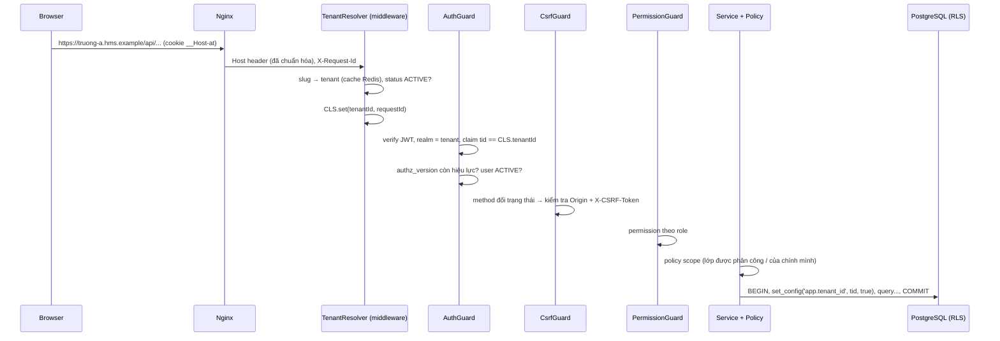

# Architecture – Homework Management System

> **DRAFT – soạn sớm theo yêu cầu, chờ duyệt ở Phase 2.** Áp dụng các quyết định D1, D2, D3, D11, D12 trong [decisions.md](./decisions.md).

---

## 1. Mục tiêu và ràng buộc kiến trúc

| Mục tiêu | Hệ quả thiết kế |
|---|---|
| Multi-tenant, cô lập dữ liệu (D3) | Ba lớp bảo vệ: tenant context ở ứng dụng, khóa ngoại kép, PostgreSQL RLS |
| Cookie httpOnly + CSRF, mở rộng Bearer (D2) | Web và API **cùng origin** theo từng subdomain; guard xác thực đọc được cả cookie và header |
| AI là module độc lập, tắt mặc định, không phát sinh chi phí (D9, D11) | Interface provider, cổng kiểm tra nhiều tầng, ngân sách đặt trước |
| Không mất dữ liệu bài nộp | Ghi DB trước; xử lý sau qua transactional outbox + queue |
| Mở rộng nhóm, ngân hàng câu hỏi, PDF, điểm cao nhất (D6.4, D12) | Điểm mở rộng có sẵn trong schema và interface |
| Dễ bảo trì | Modular monolith (NestJS modules) + worker riêng; chưa cần microservices |

---

## 2. Tổng quan

### 2.1 Thành phần runtime

```
                        *.hms.example  (wildcard DNS + TLS)
                                 │
                         ┌───────▼────────┐
                         │     Nginx      │  TLS, HSTS, gzip, rate limit tầng biên,
                         └───┬────────┬───┘  giới hạn body upload, request-id
                 /  (UI)     │        │  /api/*
                ┌────────────▼──┐  ┌──▼─────────────────┐
                │  apps/web     │  │  apps/api (NestJS) │
                │  Next.js      │  │  REST + Swagger    │
                └───────────────┘  │  TenantResolver    │
                                   │  Auth/CSRF guards  │
                                   │  Policy layer      │
                                   └──┬────────┬────────┘
                         hms_app (RLS)│        │ enqueue (qua outbox relay)
                    ┌─────────────────▼─┐   ┌──▼──────────┐
                    │  PostgreSQL 16    │   │  Redis 7    │
                    │  RLS, roles       │   │  BullMQ,    │
                    └─────────▲─────────┘   │  cache,     │
                              │             │  rate limit │
                 hms_app /    │             └──▲──────────┘
                 hms_system   │                │
                    ┌─────────┴────────────────┴──┐       ┌──────────────────┐
                    │ apps/worker (NestJS)        │──────▶│ S3 / MinIO       │
                    │ outbox relay, scheduler,    │       │ bucket private   │
                    │ notifications, auto-submit, │       └──────────────────┘
                    │ AI grading, retention       │──────▶ AI Provider
                    └─────────────────────────────┘        (Disabled khi chưa phê duyệt)

  admin.hms.example → khu vực Platform Admin (cùng apps/web + apps/api, realm khác)
```

- Web và API của một trường phục vụ trên **cùng host** `{slug}.hms.example` (`/` cho UI, `/api` cho API), nên không cần CORS. Cookie `__Host-` chỉ gắn với host đó.
- Platform Admin dùng host riêng `admin.hms.example`, cookie riêng, realm xác thực riêng.

### 2.2 Cấu trúc monorepo (pnpm workspaces)

```
apps/
  web/                Next.js (App Router), route group theo vai trò
  api/                NestJS HTTP API
  worker/             NestJS standalone: BullMQ processors, scheduler, outbox relay
packages/
  shared/             Zod schemas, enum trạng thái, permission codes, DTO types
  database/           Prisma schema, migrations (kèm SQL cho RLS/trigger), tenant-aware client
  ai-grading/         AI Grading Engine: provider interface, anonymizer, prompt builder,
                      output validator, cost estimator (không phụ thuộc NestJS)
  config/             ESLint, tsconfig, Prettier
docker/               Dockerfile, compose (dev, prod), nginx
docs/
```

`packages/ai-grading` là thư viện thuần TypeScript, test được độc lập, không truy cập DB (D11.2). Worker là nơi duy nhất gọi nó với provider thật.

### 2.3 Lựa chọn thư viện chính

| Mục đích | Thư viện |
|---|---|
| UI | Next.js, React, TypeScript, Tailwind CSS, shadcn/ui, Lucide, React Hook Form, Zod, TanStack Query |
| Rich text / công thức | Tiptap (JSON) + KaTeX |
| API | NestJS, `@nestjs/swagger`, Zod validation pipe (chung schema với web), `nestjs-cls` (AsyncLocalStorage) |
| ORM | Prisma (client extension cho tenant context) |
| Queue | BullMQ |
| Auth | `argon2`, `jose` (JWT), `otplib` (TOTP cho Platform Admin) |
| Rate limit | `@nestjs/throttler` với storage Redis |
| Storage | `@aws-sdk/client-s3` + `s3-request-presigner` |
| Excel | `exceljs` |
| AI | `@anthropic-ai/sdk` (chỉ khởi tạo khi provider = anthropic, sau phê duyệt) |
| Log | `pino` (JSON) |
| Test | Vitest/Jest, Supertest, PostgreSQL/Redis thật trong Docker, Playwright |

---

## 3. Multi-tenancy

### 3.1 Yêu cầu (D3)

1. Mỗi trường là tenant độc lập; dữ liệu cô lập.
2. Kiểm tra tenant context ở backend cho mọi API.
3. `tenant_id` trong DB và ràng buộc chống truy cập chéo.
4. Quy mô: nhiều trường, mỗi trường nhiều lớp/môn/năm học. Ước lượng thiết kế: vài trăm tenant, tới vài nghìn user/tenant, hàng triệu bài nộp tổng cộng.

### 3.2 So sánh các phương án isolation

| Tiêu chí | A. Database riêng mỗi tenant | B. Schema riêng mỗi tenant | C. Dùng chung schema + `tenant_id` (chỉ lọc ở ứng dụng) | **D. Dùng chung schema + `tenant_id` + RLS + khóa ngoại kép** |
|---|---|---|---|---|
| Mức cô lập | Rất cao (vật lý) | Cao (logic theo namespace) | Thấp – phụ thuộc hoàn toàn vào code | **Cao** – DB tự chặn khi code sai |
| Rủi ro rò dữ liệu do bug | Rất thấp | Thấp (nếu `search_path` đúng) | **Cao**: một query thiếu `WHERE tenant_id` là lộ | Thấp: RLS fail-closed |
| Migration | Chạy N lần, dễ lệch phiên bản | Chạy N lần | 1 lần | 1 lần |
| Hỗ trợ của Prisma | Phải quản lý N client/connection | Kém (schema động không được hỗ trợ tốt) | Tốt | Tốt (client extension + `set_config`) |
| Connection pool | N pool, tốn tài nguyên | Chung pool nhưng `search_path` dễ rò khi pool | Chung pool | Chung pool; context gắn vào **transaction** nên không rò |
| Chi phí vận hành | Cao | Trung bình–cao (hàng trăm schema làm phình catalog) | Thấp | Thấp |
| Onboarding tenant | Tạo DB, chạy migration | Tạo schema, chạy migration | Insert 1 dòng | Insert 1 dòng |
| Báo cáo liên tenant (Platform) | Khó | Khó | Dễ | Dễ (role `hms_system`) |
| Backup/restore 1 tenant | Dễ | Trung bình | Khó (lọc theo `tenant_id`) | Khó (export theo `tenant_id`) |
| Noisy neighbor | Tách hẳn | Chung tài nguyên | Chung | Chung (giảm bằng rate limit/quota) |
| Phù hợp MVP | Không | Không | Không đạt yêu cầu "ràng buộc chống truy cập chéo" | **Có** |

### 3.3 Đề xuất: Phương án D

**Shared database, shared schema, `tenant_id` trên mọi bảng nghiệp vụ, kết hợp:**

1. **Lớp ứng dụng**: tenant context bắt buộc (lấy từ host + token), mọi repository dùng client đã gắn tenant; policy layer kiểm tra scope.
2. **Lớp ràng buộc dữ liệu**: mọi bảng tenant có `UNIQUE (tenant_id, id)`; mọi khóa ngoại giữa các bảng tenant là **khóa ngoại kép** `(tenant_id, parent_id) → parent(tenant_id, id)`. Kể cả khi code gán nhầm ID của tenant khác, DB cũng từ chối.
3. **Lớp DB (RLS)**: `ENABLE` + `FORCE ROW LEVEL SECURITY` trên mọi bảng tenant; policy `tenant_id = current_setting('app.tenant_id')::uuid`; ứng dụng kết nối bằng role **không** có `BYPASSRLS` và không phải owner. Không đặt tenant context thì không thấy dòng nào (fail-closed).

Đường nâng cấp: vì mọi dòng có `tenant_id`, sau này có thể tách một tenant lớn sang database riêng (phương án A cho tenant đó) bằng cách export theo `tenant_id`. Lớp ứng dụng đã định tuyến theo tenant nên chỉ cần thêm bảng ánh xạ tenant → connection.

### 3.4 Luồng xử lý request và tenant context



Quy tắc:
- `tenantId` **chỉ** lấy từ host đã được resolver xác thực; token phải khớp. Không đọc `tenant_id` từ body/query.
- Host không khớp tenant nào hoặc tenant không `ACTIVE`: trả lỗi trước khi vào controller.
- Mọi truy cập DB của request đi qua `TenantPrismaClient`. Client gốc không được inject vào module nghiệp vụ (quy tắc ESLint `no-restricted-imports`).

### 3.5 Prisma và RLS

- **Context theo transaction**: dùng `set_config('app.tenant_id', $1, true)` (tham số thứ ba `true` nghĩa là chỉ hiệu lực trong transaction hiện tại). Không dùng `SET` cấp session để tránh context rò sang request khác dùng lại connection trong pool (an toàn cả với PgBouncer transaction mode).
- **Truy vấn đơn lẻ**: Prisma client extension bọc mỗi thao tác trong batch transaction `[set_config, query]`.
- **Nghiệp vụ nhiều bước**: helper `tenantTx(fn)` mở interactive transaction, gọi `set_config` đầu tiên, sau đó mọi thao tác dùng `tx`.
- **Kiểm thử bắt buộc**: (1) query không có context trả 0 dòng; (2) 2 request song song của 2 tenant không thấy dữ liệu của nhau; (3) insert với `tenant_id` khác context bị `WITH CHECK` chặn.

### 3.6 Database roles

| Role | Dùng bởi | Quyền | RLS |
|---|---|---|---|
| `hms_owner` | Prisma migrate (CI/deploy) | Owner schema, DDL | Không áp dụng (owner); chỉ dùng khi migrate |
| `hms_app` | apps/api, apps/worker (tác vụ của từng tenant) | DML trên bảng tenant; SELECT trên bảng tham chiếu nền tảng (permissions, pricing) | **Chịu RLS**, `NOBYPASSRLS` |
| `hms_system` | Module Platform, scheduler quét liên tenant, outbox relay, retention, báo cáo nền tảng | DML giới hạn theo bảng cần thiết | `BYPASSRLS`; chỉ inject trong các module được liệt kê; mọi thao tác ghi audit `actor_type = SYSTEM/PLATFORM` |

Bảng nền tảng (`tenants`, `platform_users`, `platform_audit_logs`, `ai_model_pricing`, `platform_settings`) **không** cấp quyền ghi cho `hms_app`.

### 3.7 Mẫu RLS policy (áp dụng cho mọi bảng tenant)

```sql
ALTER TABLE <table> ENABLE ROW LEVEL SECURITY;
ALTER TABLE <table> FORCE ROW LEVEL SECURITY;

CREATE POLICY tenant_isolation ON <table>
  USING      (tenant_id = NULLIF(current_setting('app.tenant_id', true), '')::uuid)
  WITH CHECK (tenant_id = NULLIF(current_setting('app.tenant_id', true), '')::uuid);
```

`current_setting(..., true)` trả `NULL` khi chưa đặt, khiến điều kiện so sánh không bao giờ đúng (fail-closed). Policy được tạo bằng SQL trong migration Prisma. Có một **test migration** kiểm tra mọi bảng có cột `tenant_id` đều đã bật RLS và có policy.

### 3.8 Cô lập ngoài database

| Thành phần | Cơ chế |
|---|---|
| Object storage | Key `t/{tenant_id}/{yyyy}/{mm}/{file_uuid}`; bucket private; chỉ cấp signed URL sau khi kiểm tra bản ghi `files` (có RLS) |
| Redis cache | Prefix `hms:t:{tenant_id}:…`; dữ liệu nền tảng `hms:p:…` |
| BullMQ | Payload luôn có `tenantId`; processor đặt CLS + dùng `tenantTx`. Không có job nào thiếu `tenantId`, trừ job hệ thống chạy bằng `hms_system` |
| Rate limit | Theo IP, theo user, **theo tenant** |
| Log | Mọi dòng log có `tenant_id`, `request_id`; không log nội dung bài làm, mật khẩu, token |
| Thông báo | Bảng `notifications` có RLS; API chỉ trả của user hiện tại |
| Session/JWT | Claim `tid`; cookie `__Host-` gắn với host của tenant |

### 3.9 Tác vụ liên tenant

Scheduler (mở bài theo lịch, nhắc hạn, auto-submit, retention) dùng `hms_system` **chỉ để tìm** các mục tới hạn (ví dụ `SELECT id, tenant_id FROM assignments WHERE status='SCHEDULED' AND open_at <= now()`), sau đó enqueue job **theo từng tenant**. Việc xử lý nghiệp vụ trong job chạy bằng `hms_app` với tenant context. Như vậy phạm vi code có quyền bypass RLS là nhỏ nhất.

### 3.10 Noisy neighbor và hạn mức

- Rate limit theo tenant cho API; concurrency của queue AI giới hạn theo tenant (semaphore Redis) và toàn cục.
- Hạn mức tenant (O-13): số user, dung lượng lưu trữ. Kiểm tra khi tạo user/upload.
- Index mọi bảng tenant bắt đầu bằng `tenant_id`.

### 3.11 Kiểm thử cô lập tenant (bắt buộc từ Phase 3)

1. Seed 2 tenant có dữ liệu tương đương (kể cả trùng mã HS, trùng mã lớp).
2. Với **mỗi endpoint**: dùng phiên tenant A gọi với ID của tenant B → 404/403, DB không thay đổi.
3. Test DB trực tiếp bằng role `hms_app`: không có context → 0 dòng; context A → không thấy B; insert sai tenant → lỗi.
4. Test khóa ngoại kép: tạo liên kết chéo tenant bằng `hms_system` (bypass RLS) vẫn bị FK chặn.
5. Test cookie/token của A gửi tới host B → 401.

---

## 4. Module boundaries (apps/api)

| Module | Trách nhiệm | Phụ thuộc được phép |
|---|---|---|
| `platform` | Tenant lifecycle, Platform Admin, trần cấu hình, bảng giá AI, thống kê nền tảng | `database(system)`, `audit` |
| `tenancy` | TenantResolver, cache trạng thái tenant, tenant settings | `database` |
| `auth` | Đăng nhập, phiên, refresh, CSRF, đổi/reset mật khẩu, MFA (platform) | `users`, `tenancy`, `audit` |
| `authz` | Permission catalog, role, guard, policy helpers, `authz_version` | `users` |
| `users` | Tài khoản, hồ sơ GV/HS, import Excel | `files`, `audit` |
| `academics` | Năm học, học kỳ, môn, lớp, ghi danh, phân công | `users`, `audit` |
| `assignments` | Bài tập, đối tượng nhận, lịch giao, thu hồi, nhân bản | `academics`, `questions`, `files`, `outbox` |
| `questions` | Câu hỏi, đáp án, rubric (có version) | `files` |
| `submissions` | Bắt đầu, autosave, nộp, phiên bản, nộp lại | `assignments`, `grading`, `files`, `outbox` |
| `grading` | Rule engine, chấm tay, duyệt, công bố, lịch sử điểm, điểm hiệu lực | `submissions`, `questions`, `outbox`, `audit` |
| `ai-grading` | Cổng kiểm tra, ước tính, ngân sách, tạo job, đọc kết quả (gọi provider **chỉ trong worker**) | `grading`, `packages/ai-grading`, `audit` |
| `files` | Presign, xác nhận upload, kiểm tra định dạng, signed download, hạn mức | storage |
| `notifications` | Tạo, liệt kê, đánh dấu đọc, gom nhóm | – |
| `reports` | Dashboard, thống kê, export (`ReportExporter`: Excel; PDF – ADV) | đọc từ các module (read model) |
| `audit` | Ghi/đọc audit log, truy cập nhạy cảm | – |
| `outbox` | Ghi sự kiện trong transaction nghiệp vụ | – |

Quy tắc phụ thuộc: không có vòng phụ thuộc; module chỉ gọi **service public** của module khác, không truy cập trực tiếp bảng của module khác. `reports` đọc qua truy vấn chỉ đọc có kiểm soát.

### 4.1 Phân lớp trong module

```
Controller   – HTTP, DTO (Zod), Swagger, @RequirePermission(...)
  └ Service  – nghiệp vụ, transaction (tenantTx), gọi Policy
      ├ Policy      – kiểm tra scope: lớp được phân công, sở hữu, chính chủ
      ├ Repository  – Prisma (tenant-aware), luôn nhận scope
      └ Serializer  – trả DTO theo vai trò (ví dụ ẩn đáp án với HS)
```

---

## 5. Xử lý bất đồng bộ

### 5.1 Transactional outbox

Mọi sự kiện cần xử lý sau (thông báo, lên lịch, chấm lại, job AI) được ghi vào `outbox_events` **trong cùng transaction** với thay đổi nghiệp vụ. Worker relay (dùng `FOR UPDATE SKIP LOCKED`) đẩy sang BullMQ rồi đánh dấu đã xử lý. Như vậy không có thông báo cho thao tác đã rollback, và không mất sự kiện khi Redis tạm lỗi.

### 5.2 Queues

| Queue | Job | Ghi chú |
|---|---|---|
| `notifications` | Tạo thông báo, gom nhóm | Idempotent theo `dedupe_key` |
| `scheduling` | Mở bài theo lịch, nhắc hạn, đánh dấu quá hạn | Delayed jobs + quét định kỳ dự phòng |
| `submissions` | Auto-submit khi hết giờ | Delay tới deadline cá nhân |
| `grading` | Chấm lại tự động khi đổi đáp án | |
| `ai-grading` | Thực thi job AI | Concurrency theo tenant + toàn cục; retry backoff; **không đăng ký processor nếu `AI_PROVIDER=disabled`** |
| `maintenance` | Dọn file mồ côi, retention, chốt kỳ ngân sách | `hms_system` để quét |

---

## 6. File storage

1. Client xin upload → API kiểm tra quyền, loại file khai báo, dung lượng, hạn mức → tạo `files` (`PENDING`) → trả presigned PUT (hết hạn 5 phút, kèm điều kiện content-length).
2. Client upload trực tiếp lên storage.
3. Client gọi xác nhận → API đọc phần đầu file (magic bytes) từ storage, đối chiếu định dạng cho phép, dung lượng thật, checksum → `ACTIVE`; không hợp lệ thì xóa object, `REJECTED`.
4. Download: API kiểm tra quyền trên bản ghi chủ (bài tập/bài nộp) → signed GET 60–300 giây, `Content-Disposition: attachment`.
5. Storage dùng domain riêng, khác domain ứng dụng, để file không chạy được trong origin của app.

---

## 7. Frontend

- Next.js App Router, route groups: `(auth)`, `(student)`, `(teacher)`, `(school-admin)`, `(platform)`.
- Gọi API cùng origin (`/api`) từ trình duyệt bằng TanStack Query, `credentials: 'include'`; header `X-CSRF-Token` lấy từ cookie CSRF. **Không** lưu token ở `localStorage`/`sessionStorage` (D2.2).
- Middleware Next.js chỉ dùng để điều hướng UI (đã đăng nhập hay chưa). Quyền thực sự luôn kiểm tra ở API.
- Design tokens (màu, radius, font) khai báo một lần trong Tailwind theme + CSS variables.
- Bản nháp tạm ở `localStorage` chỉ chứa câu trả lời đang soạn, có khóa theo user + bài, xóa khi nộp thành công.

---

## 8. Cấu hình & môi trường

| Biến | Ý nghĩa | Mặc định |
|---|---|---|
| `DATABASE_URL` | Kết nối `hms_app` | – |
| `DATABASE_SYSTEM_URL` | Kết nối `hms_system` | – |
| `MIGRATION_DATABASE_URL` | Kết nối `hms_owner` (chỉ CI/deploy) | – |
| `REDIS_URL` | Redis | – |
| `APP_BASE_DOMAIN` | Domain gốc, ví dụ `hms.example` | – |
| `PLATFORM_HOST` | Host khu vực Platform | `admin.{APP_BASE_DOMAIN}` |
| `JWT_*` | Khóa ký (Ed25519/ES256), thời hạn | access 15 phút, refresh 14 ngày |
| `AUTH_BEARER_ENABLED` | Bật Bearer cho client ngoài trình duyệt | `false` |
| `S3_*` | Endpoint, bucket, khóa | – |
| `AI_PROVIDER` | `disabled` \| `anthropic` \| `fake` (chỉ test) | **`disabled`** |
| `AI_GRADING_MODEL` | Model khi provider = anthropic | `claude-opus-5-5` |
| `ANTHROPIC_API_KEY` | Chỉ ở secret của worker; không cấp cho api/web | không đặt |

Ứng dụng **từ chối khởi động** khi: `NODE_ENV=production` và `AI_PROVIDER=fake`; hoặc `AI_PROVIDER=anthropic` mà thiếu key; hoặc role `hms_app` có `BYPASSRLS` (kiểm tra lúc khởi động).

---

## 9. Quan sát hệ thống

- Log JSON (pino) với `request_id`, `tenant_id`, `user_id`, `route`, `duration`; che (redact) cookie, header Authorization, mật khẩu, nội dung câu trả lời.
- Health: `/api/health/live`, `/api/health/ready` (DB, Redis, storage).
- Metric: độ dài queue, job lỗi, thời gian xử lý AI, chi phí AI theo tenant, truy vấn chậm.
- Audit log nghiệp vụ tách khỏi log kỹ thuật.

---

## 10. Điểm mở rộng đã thiết kế

| Mở rộng | Điểm móc |
|---|---|
| Giao theo nhóm (D12) | `assignment_targets.target_type = GROUP` + bảng nhóm |
| Ngân hàng câu hỏi (D12) | `questions.source_question_id`; module `question-bank` riêng, sao chép vào bài |
| Xuất PDF (D12) | `ReportExporter` interface; cài đặt render HTML → PDF bằng Chromium |
| Điểm cao nhất (D6.4) | `grading_policy = HIGHEST`; hàm tính điểm hiệu lực tập trung trong `grading` |
| Bearer / mobile (D2.3) | `AuthGuard` đọc token từ cookie **hoặc** `Authorization`; endpoint cấp token cho client đã đăng ký; CSRF chỉ áp dụng khi xác thực bằng cookie |
| AI provider khác / Batch API | `AiGradingProvider` interface |
| Email | Kênh thông báo `NotificationChannel` |
| Tách tenant lớn sang DB riêng | Bảng ánh xạ tenant → datasource (tương lai) |
