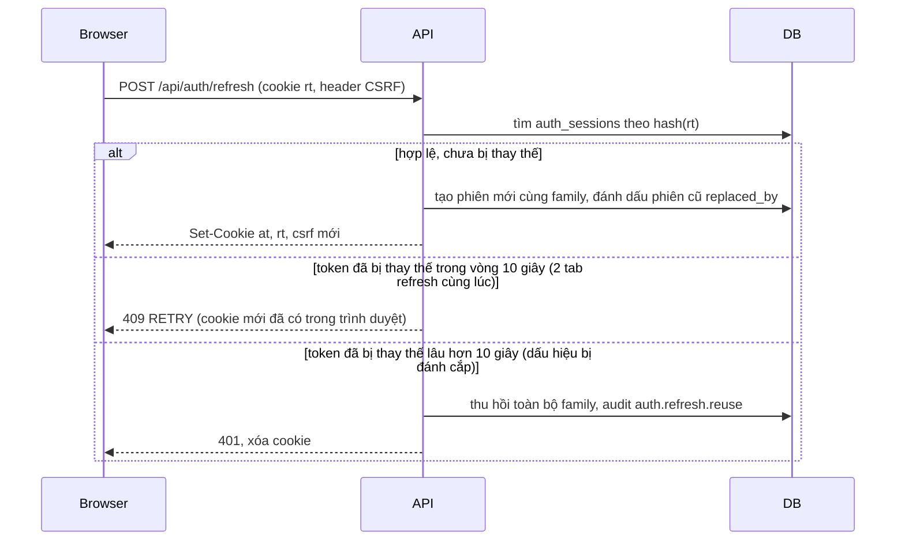

# Authentication & Authorization – Homework Management System

> **DRAFT – soạn sớm theo yêu cầu, chờ duyệt ở Phase 2.** Áp dụng D2, D3, D4, D7, D8 trong [decisions.md](./decisions.md). Liên quan: [architecture.md](./architecture.md), [security.md](./security.md).

---

## 1. Realm xác thực

| Realm | Host | Người dùng | Bảng | Ghi chú |
|---|---|---|---|---|
| **Tenant** | `{slug}.<domain>` (O-01) | School Admin, Teacher, Student | `users`, `auth_sessions` | Mỗi trường một host, cookie riêng |
| **Platform** | `admin.<domain>` | Platform Admin | `platform_users`, `platform_sessions` | MFA TOTP bắt buộc (O-10) |

Hai realm dùng khóa ký JWT khác nhau (hoặc `aud` khác nhau và được kiểm tra nghiêm ngặt). Token của realm này không dùng được ở realm kia.

---

## 2. Xác định tenant

1. Nginx chuyển tiếp `Host` (đã chuẩn hóa chữ thường, bỏ port). Request có host không thuộc `*.<domain>` bị từ chối ở Nginx.
2. `TenantResolver` tách `slug` → tra `tenants` (cache Redis 60 giây, xóa cache khi tenant thay đổi) → kiểm tra `status = ACTIVE`.
3. Host dùng chung (ví dụ `app.<domain>`, O-01 dự phòng): trang đăng nhập có ô "Mã trường", đăng nhập xong **chuyển hướng** sang `{slug}.<domain>` (phiên chỉ tồn tại trên host của trường).
4. `tenantId` được đặt vào CLS (AsyncLocalStorage) và là nguồn duy nhất cho tenant context. Không đọc `tenant_id` từ body, query hay header tùy ý (BR-T02).

---

## 3. Đăng nhập

### 3.1 Định danh

| Vai trò | Định danh | Chuẩn hóa |
|---|---|---|
| Student | **Mã học sinh** (D4.1) | Trim, NFC, không phân biệt hoa thường (`citext`) |
| Teacher, School Admin | Username hoặc email | Như trên |
| Platform Admin | Email | Như trên |

Tra cứu luôn theo `(tenant_id, username)` hoặc `(tenant_id, email)`. Trùng mã HS giữa hai trường là hợp lệ (D4.2).

### 3.2 Mật khẩu

| Hạng mục | Quy định |
|---|---|
| Băm | **Argon2id** (tham số khởi điểm: m = 19 MiB, t = 2, p = 1; đo lại trên máy production và cấu hình qua env) |
| Độ dài | 8–128 ký tự; không bắt buộc quy tắc ký tự phức tạp; **chặn mật khẩu phổ biến/đã lộ** (danh sách cục bộ) và chặn mật khẩu trùng username/mã HS/họ tên |
| Mật khẩu tạm | 12 ký tự ngẫu nhiên (CSPRNG) từ bảng chữ không gây nhầm lẫn (bỏ `0 O 1 l I`); **không suy ra từ mã HS** (D4.3) |
| Bàn giao mật khẩu tạm | Hiển thị một lần / file tải một lần (O-18); không ghi vào log hay audit |
| Lần đầu đăng nhập | `must_change_password = true` → chỉ được gọi API đổi mật khẩu và đăng xuất |
| Đổi mật khẩu | Yêu cầu mật khẩu hiện tại; thu hồi các phiên khác |
| Reset bởi School Admin | Sinh mật khẩu tạm mới, thu hồi mọi phiên, tăng `authz_version`, audit |

### 3.3 Chống brute force

- Rate limit (Redis): theo IP (ví dụ 20 lần/phút), theo `(tenant, định danh)` (5 lần/15 phút), theo tenant (ngưỡng tổng để phát hiện tấn công diện rộng).
- Sai 5 lần liên tiếp: khóa tạm 5 phút, tăng gấp đôi mỗi lần tiếp theo, tối đa 1 giờ (`users.locked_until`).
- Thông báo lỗi chung "Mã đăng nhập hoặc mật khẩu không đúng" cho mọi trường hợp sai; thời gian phản hồi đồng đều (vẫn chạy Argon2 với hash giả khi không tìm thấy user).
- Audit `auth.login.failed` (không ghi mật khẩu đã nhập).

### 3.4 Platform Admin

Mật khẩu + **TOTP** bắt buộc; mã khôi phục dùng một lần (lưu hash); phiên ngắn hơn (§4.3); tùy chọn giới hạn IP truy cập (cấu hình). Platform Admin đầu tiên được tạo bằng lệnh CLI.

---

## 4. Phiên đăng nhập, token và cookie (D2)

### 4.1 Cookie (realm tenant)

| Cookie | Nội dung | Thuộc tính | Thời hạn |
|---|---|---|---|
| `__Host-hms_at` | Access token (JWT) | `HttpOnly; Secure; SameSite=Lax; Path=/` | 15 phút |
| `__Host-hms_rt` | Refresh token (chuỗi ngẫu nhiên 256-bit, DB chỉ lưu SHA-256) | `HttpOnly; Secure; SameSite=Strict; Path=/` | 14 ngày không hoạt động, tối đa 30 ngày tuyệt đối |
| `__Host-hms_csrf` | CSRF token (HMAC gắn với `sid`) | `Secure; SameSite=Strict; Path=/` (**không** HttpOnly để JS đọc và gửi qua header) | Theo phiên |

- Tiền tố `__Host-` bắt buộc cookie không có `Domain` → cookie **chỉ gắn với đúng host của trường**, không lộ sang subdomain khác (chống rò chéo tenant ở tầng trình duyệt).
- **Không** lưu token trong `localStorage`/`sessionStorage` (D2.2). Frontend không bao giờ đọc được access/refresh token.
- Realm Platform dùng bộ cookie riêng (`__Host-hmsp_*`) trên host `admin.<domain>`.

### 4.2 Access token (JWT)

- Thuật toán: EdDSA (Ed25519) hoặc ES256, có `kid` để xoay vòng khóa.
- Claims: `iss`, `aud` (`hms-tenant` / `hms-platform`), `sub` (user id), `tid` (tenant id), `sid` (session id), `rv` (`authz_version`), `iat`, `exp`. **Không** đưa danh sách quyền hay thông tin cá nhân vào token.
- Mỗi request: kiểm tra chữ ký, `exp`, `aud`; **`tid` phải bằng tenant của host**; tra cache Redis `hms:t:{tid}:u:{sub}` → `{status, rv, permissions}` (TTL 5 phút, xóa chủ động khi đổi role/phân công/khóa). Nếu `status ≠ ACTIVE` hoặc `rv` khác thì trả 401 `SESSION_STALE` để client làm mới phiên.

### 4.3 Refresh và vòng đời phiên



| Sự kiện | Xử lý |
|---|---|
| Đăng xuất | Thu hồi phiên hiện tại, xóa cookie |
| Đăng xuất mọi nơi | Thu hồi mọi phiên của user |
| Khóa tài khoản / reset mật khẩu / đổi role / gỡ phân công | Tăng `authz_version` + xóa cache; khóa/reset còn thu hồi mọi phiên |
| Tenant bị tạm ngưng | Thu hồi mọi phiên của tenant, cache trạng thái tenant cập nhật ngay |
| Phiên Platform | Access 10 phút, phiên tuyệt đối 8 giờ, yêu cầu TOTP lại khi hết phiên |

Frontend dùng cơ chế **single-flight** (một request refresh dùng chung giữa các tab qua `BroadcastChannel`) để hạn chế refresh đồng thời.

### 4.4 Chống CSRF

1. `SameSite=Lax` cho access cookie và `Strict` cho refresh/CSRF cookie.
2. **Double-submit token gắn phiên**: mọi request đổi trạng thái (`POST/PUT/PATCH/DELETE`) phải có header `X-CSRF-Token` khớp cookie `__Host-hms_csrf`, và token phải là HMAC hợp lệ của `sid` hiện tại.
3. Kiểm tra `Origin` (hoặc `Referer` khi thiếu `Origin`) bằng đúng host của tenant.
4. Form đăng nhập dùng CSRF token trước phiên (chống login CSRF).
5. CSRF guard **chỉ bỏ qua** khi request xác thực bằng Bearer và **không có** cookie phiên (§4.5).

### 4.5 Mở rộng Bearer cho mobile/API client (D2.3, chưa bật)

- `AuthGuard` dùng chuỗi trích xuất token: cookie `__Host-hms_at` → header `Authorization: Bearer`. Nếu cả hai cùng có thì từ chối (tránh nhầm lẫn).
- Bearer chỉ được chấp nhận khi `AUTH_BEARER_ENABLED=true` (mặc định `false`).
- Phiên Bearer có `client_type = BEARER`; refresh qua body tới `/api/auth/token/refresh` (không dùng cookie); token có `aud` riêng (`hms-tenant-api`).
- Tenant vẫn được xác định từ host (`{slug}.<domain>/api`), không từ token.
- Khi bật: bổ sung đăng ký client, giới hạn scope và rate limit riêng.

---

## 5. Danh mục permission

Scope: **T** = toàn tenant · **A** = lớp/môn được phân công (Teacher) · **O** = của chính mình.

| Permission | Mô tả | SCHOOL_ADMIN | TEACHER | STUDENT |
|---|---|---|---|---|
| `tenant.settings.read` / `.update` | Cấu hình trường | T | – | – |
| `tenant.ai.manage` | Bật/tắt AI trường, ghi nhận phê duyệt, ngân sách | T | – | – |
| `user.read` | Xem tài khoản | T | A (HS lớp mình) | – |
| `user.create` / `.update` / `.lock` | Quản lý tài khoản | T | – | – |
| `user.password.reset` | Reset mật khẩu | T | – | – |
| `user.import` | Import Excel | T | – | – |
| `academic.manage` | Năm học, học kỳ, môn, lớp | T | – | – |
| `academic.read` | Xem danh mục học vụ | T | T | O (lớp mình) |
| `enrollment.manage` | Ghi danh HS | T | – | – |
| `teaching_assignment.manage` | Phân công GV, chuyển quyền sở hữu bài | T | – | – |
| `class.read` | Xem lớp, danh sách HS | T | A | O |
| `assignment.read` | Xem bài tập | T | A | O (bài được giao, không đáp án) |
| `assignment.manage` | Tạo/sửa/giao/thu hồi/nhân bản | – | A (bài mình sở hữu) | – |
| `submission.read` | Xem danh sách + trạng thái bài nộp | T | A | O |
| `submission.content.read` | **Xem nội dung bài làm** (nhạy cảm, D7.2) | T (O-04, bắt buộc lý do + audit) | A | O |
| `submission.write` | Làm bài, lưu nháp, nộp | – | – | O |
| `submission.return` | Yêu cầu nộp lại | – | A | – |
| `grade.read` | Xem điểm | T | A | O (chỉ sau công bố) |
| `grade.write` | Chấm, duyệt, sửa điểm | – | A | – |
| `grade.publish` | Công bố điểm | – | A | – |
| `grade.override` | Sửa điểm thay GV (O-05) | Không gán mặc định | – | – |
| `ai_grading.request` | Kích hoạt AI, xem ước tính | – | A | – |
| `ai_grading.read` | Xem kết quả AI | – | A | – |
| `ai_usage.read` | Thống kê chi phí/token AI | T | O (của mình) | – |
| `report.read` | Báo cáo | T | A | O |
| `report.export` | Xuất Excel (ghi audit) | T | A | – |
| `audit.read` | Xem audit log của trường | T | – | – |
| `notification.read` | Thông báo của mình | O | O | O |

Permission Platform (realm riêng): `platform.tenant.manage`, `platform.settings.manage`, `platform.ai.manage` (kill switch, bảng giá), `platform.stats.read`, `platform.audit.read`. **Không có** permission đọc nội dung bài làm của tenant (O-03).

---

## 6. Quy tắc phạm vi (scope)

| Đối tượng | Teacher (A) | Student (O) | School Admin (T) |
|---|---|---|---|
| Lớp C | Có `class_teachers` đang hiệu lực với C | Đang ghi danh trong C | Mọi lớp |
| Bài tập A | **Quản lý** khi `owner_teacher_id = mình`. **Xem** khi mình được phân công (lớp đích, môn của A) | Theo BR-11 | Mọi bài (chỉ đọc) |
| Bài nộp S (bài A, HS X) | `owner_teacher_id = mình` **và** đang được phân công (lớp C, môn của A) với X đang ghi danh trong C (hoặc X là đích trực tiếp và thuộc lớp mình dạy môn đó) | X = mình | Mọi bài nộp (nội dung cần `submission.content.read`) |
| Điểm | Như bài nộp | Của mình, chỉ khi `PUBLISHED` | Đọc; ghi chỉ khi có `grade.override` |

Phân công được tính **tại thời điểm request** (BR-03).

---

## 7. Các lớp kiểm tra quyền (defense in depth)

```
1. Nginx            : host hợp lệ, giới hạn body, rate limit thô
2. TenantResolver   : host → tenant ACTIVE → CLS
3. AuthGuard        : token hợp lệ, realm đúng, tid == tenant của host, user ACTIVE, rv khớp
4. CsrfGuard        : request đổi trạng thái qua cookie
5. MustChangePwd    : chặn mọi API trừ đổi mật khẩu/đăng xuất khi cần
6. PermissionGuard  : @RequirePermission('grade.publish')
7. Policy (service) : scope A/O/T trên đối tượng cụ thể; ném NotFound khi ngoài scope
8. Repository       : query luôn kèm điều kiện scope
9. RLS (PostgreSQL) : chặn mọi dòng ngoài tenant
10. Serializer      : lọc trường theo vai trò (đáp án, nhận xét AI, điểm chưa công bố)
```

Quy ước mã lỗi:
- **401**: chưa đăng nhập / phiên hết hạn / token không khớp tenant.
- **403**: đã đăng nhập nhưng thiếu permission cho **loại** thao tác (ví dụ HS gọi API chấm điểm), hoặc CSRF sai.
- **404**: đối tượng ngoài scope hoặc ngoài tenant. Không phân biệt "không tồn tại" với "không có quyền", để không lộ sự tồn tại.
- **409**: xung đột trạng thái (đã nộp, hết lượt, cổng AI đóng, sai revision).

---

## 8. Audit cho truy cập nhạy cảm và chỉnh sửa điểm (D7.3)

| Hành động | Audit | `is_sensitive` | Lý do bắt buộc |
|---|---|---|---|
| School Admin xem nội dung bài làm | `submission.content.read` | ✔ | ✔ |
| School Admin xem điểm chi tiết của một HS | `grade.read.detail` | ✔ | ✔ |
| Xuất Excel có dữ liệu cá nhân/điểm | `report.export` | ✔ | – |
| Tải file kết quả import (mật khẩu tạm) | `user.import.result_download` | ✔ | – |
| GV mở grading workspace của một bài nộp | `submission.grading.open` | – (O-21) | – |
| Mọi thay đổi điểm/nhận xét | `grade_history` + `grade.update` | – | Khi đã công bố / ghi đè |
| `grade.override` bởi School Admin | `grade.override` + thông báo GV | ✔ | ✔ |
| Cấu hình AI / ngân sách | `tenant.ai.update` (giá trị cũ/mới) | – | – |
| Đổi role, phân công, khóa, reset mật khẩu | `user.*`, `teaching_assignment.*` | – | – |
| Từ chối truy cập (403/404 do policy) | `access.denied` (lấy mẫu để tránh quá tải) | – | – |

Ghi audit cho truy cập nhạy cảm nằm **trong cùng transaction** với lần đọc; ghi audit thất bại thì không trả dữ liệu.

---

## 9. Kiểm thử bắt buộc

- Đăng nhập HS bằng mã HS; trùng mã HS ở 2 tenant đăng nhập đúng tenant.
- Mật khẩu tạm không chứa/không bằng mã HS; hash Argon2id; không có mật khẩu dạng rõ trong log.
- Khóa tạm sau N lần sai; thông báo lỗi chung.
- Cookie có `__Host-`, `HttpOnly`, `Secure`, `SameSite` đúng; không có token trong body response của luồng web.
- Thiếu/sai CSRF → 403; `Origin` lạ → 403.
- Refresh xoay vòng; dùng lại token cũ → thu hồi family.
- Token tenant A gửi tới host B → 401. Token tenant gửi tới realm Platform → 401.
- Khóa tài khoản / gỡ phân công → request tiếp theo bị từ chối (trong thời gian TTL cache tối đa, và ngay lập tức khi cache được xóa chủ động).
- Ma trận permission: mỗi endpoint có test cho cả role được phép và không được phép.
- Truy cập nhạy cảm tạo bản ghi audit có lý do.
