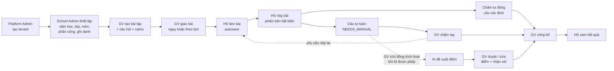
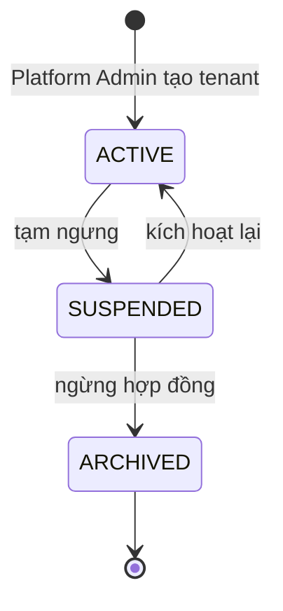
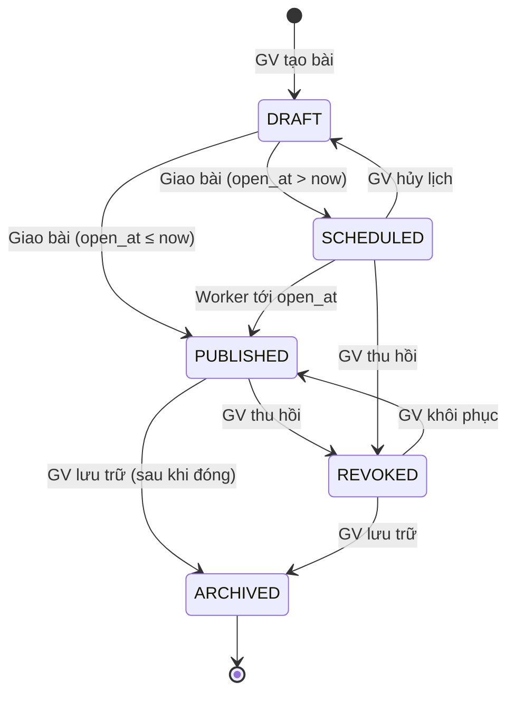
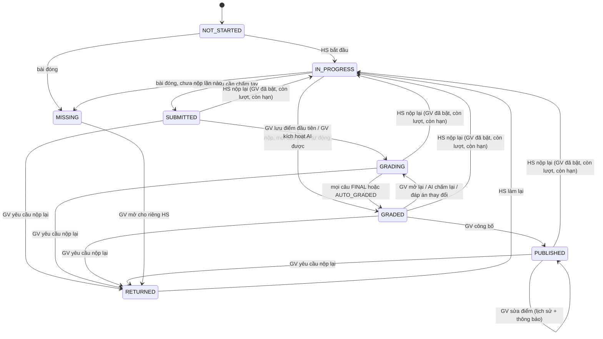
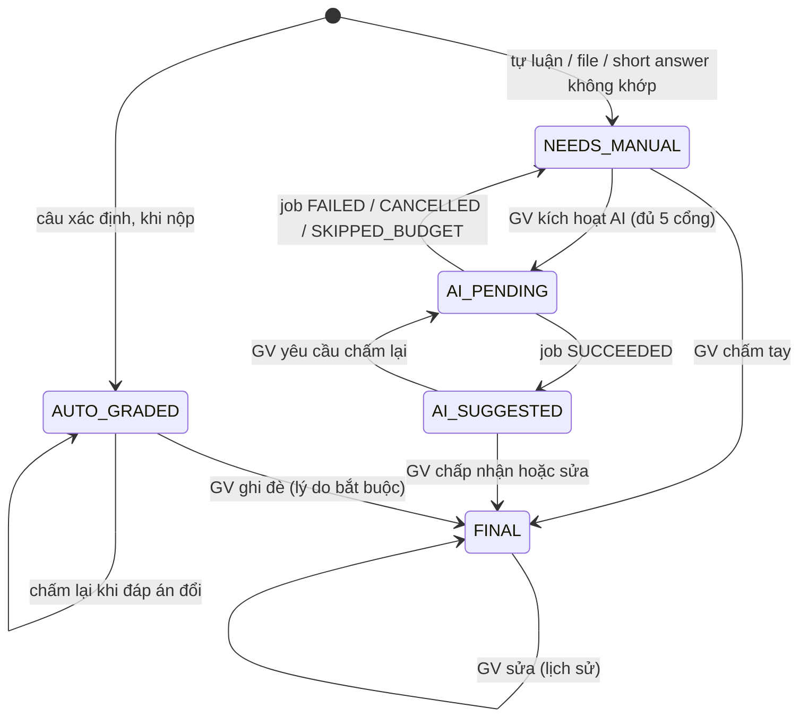
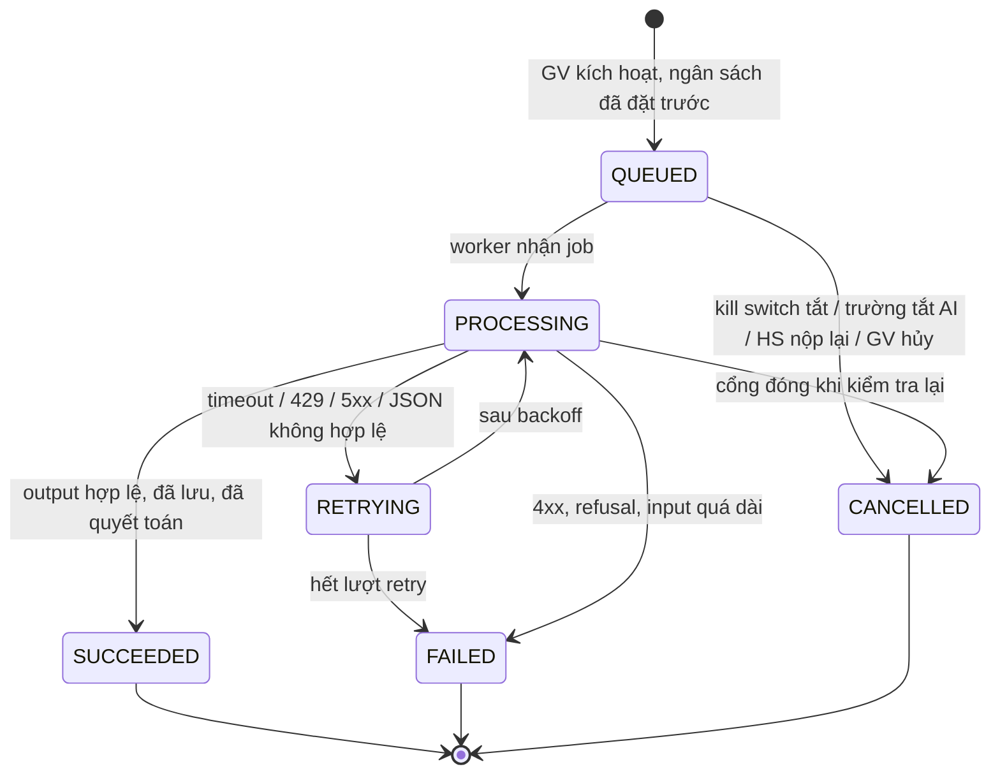
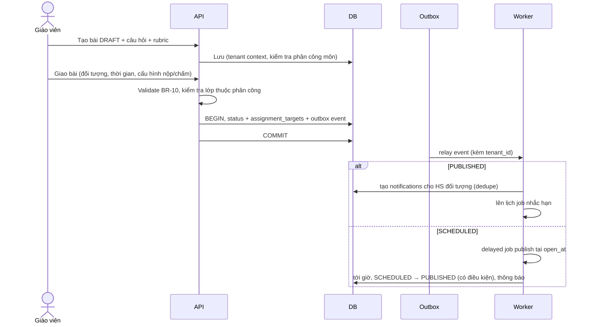
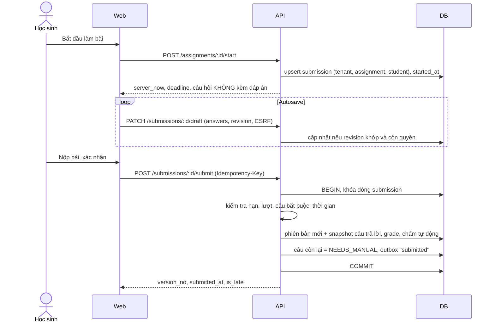
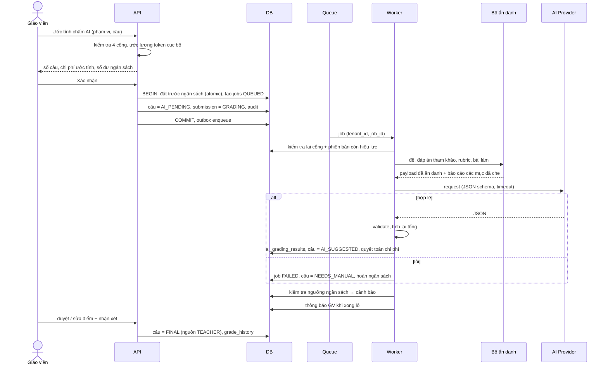
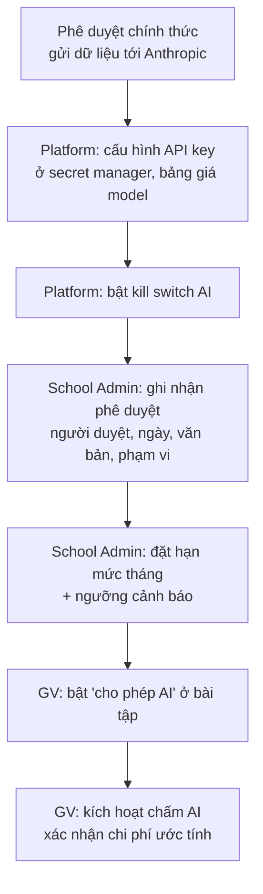

# Business Workflows – Homework Management System

> Phase 1 – Discovery & Requirement Analysis · **Bản 2 – DRAFT chờ review**
> Business rule (BR-xx): [requirements.md](./requirements.md). Use case (UC-xx): [use-cases.md](./use-cases.md). Quyết định (D-xx/O-xx): [decisions.md](./decisions.md).
> Tên enum trạng thái khớp với [database-design.md](./database-design.md).

---

## 1. Tổng quan luồng nghiệp vụ chính

---

## 2. Trạng thái Tenant

| Trạng thái | Ý nghĩa |
|---|---|
| `ACTIVE` | Hoạt động bình thường |
| `SUSPENDED` | Tạm ngưng: chặn đăng nhập và mọi API của tenant, dừng job theo lịch, giữ dữ liệu (BR-T04) |
| `ARCHIVED` | Ngừng sử dụng, chỉ Platform truy cập (xuất dữ liệu). Xóa theo retention là tính năng nâng cao |

Khi chuyển sang `SUSPENDED`: thu hồi mọi refresh token của tenant, cập nhật cache trạng thái tenant (mọi request sau đó nhận 403 `TENANT_SUSPENDED`), job theo lịch của tenant bỏ qua khi tới hạn.

---

## 3. Trạng thái Assignment

### 3.1 Trạng thái lưu trữ

| Trạng thái | Ý nghĩa | HS thấy? |
|---|---|---|
| `DRAFT` | Đang soạn | Không |
| `SCHEDULED` | Đã cấu hình giao, chờ `open_at` | Không |
| `PUBLISHED` | Đang hiệu lực | Có (nếu thuộc đối tượng nhận) |
| `REVOKED` | Đã thu hồi, giữ dữ liệu, khôi phục được | Không |
| `ARCHIVED` | Lưu trữ, chỉ đọc | Chỉ đọc kết quả đã công bố |

Ràng buộc: chỉ giao khi thỏa BR-10; `SCHEDULED → DRAFT` chỉ trước `open_at`; đã có bài nộp thì không về `DRAFT` (BR-13); chỉ lưu trữ khi đã đóng hoặc đã thu hồi.

### 3.2 Giai đoạn thời gian (tính toán, khi `PUBLISHED`)

| Giai đoạn | Điều kiện | Hành vi |
|---|---|---|
| `UPCOMING` | `now < open_at` | HS chưa thấy |
| `OPEN` | `open_at ≤ now ≤ due_at` | Nộp đúng hạn |
| `LATE_PERIOD` | `due_at < now ≤ late_until`, cho nộp muộn | Nộp được, `is_late = true` |
| `CLOSED` | Qua hạn đóng | Không nộp được, trừ HS đang `RETURNED` có hạn riêng |

### 3.3 Tiến độ chấm (tính toán, dashboard GV)

`Chưa đến hạn` · `Đang nhận bài` · `Chờ chấm` (có bài `SUBMITTED`/`GRADING`) · `Đã chấm` (mọi bài đã nộp ở `GRADED`/`PUBLISHED`) · `Đã công bố`.

---

## 4. Trạng thái Submission

Một cặp (bài tập, HS) có **1 submission** (chứa bản nháp hiện tại) và **nhiều phiên bản bất biến** (mỗi lần nộp một phiên bản – D6.2). Mỗi phiên bản có **một bản ghi điểm** riêng.

### 4.1 Trạng thái

| Trạng thái | Lưu/Tính | Ý nghĩa |
|---|---|---|
| `NOT_STARTED` | Tính | Chưa mở làm bài (chưa có bản ghi) |
| `IN_PROGRESS` | Lưu | Đang làm, có bản nháp |
| `SUBMITTED` | Lưu | Đã nộp; phần tự động đã chấm; còn câu `NEEDS_MANUAL` và **GV chưa bắt đầu xử lý** |
| `GRADING` | Lưu | GV đã bắt đầu: đã lưu điểm một phần, **hoặc** đã kích hoạt AI (đang chạy hoặc đã có gợi ý chờ duyệt) |
| `GRADED` | Lưu | Mọi câu có điểm chính thức; chưa công bố |
| `PUBLISHED` | Lưu | Đã công bố |
| `RETURNED` | Lưu | GV yêu cầu nộp lại |
| `MISSING` | Tính | Bài đã đóng mà HS chưa có phiên bản nộp nào |

Thuộc tính đi kèm: `is_late`, `attempt_count`, `auto_submitted`.

Ghi chú:
- Nộp lại từ `PUBLISHED`: điểm đã công bố của phiên bản trước vẫn là điểm hiệu lực và vẫn hiển thị cho tới khi phiên bản mới được công bố (D6.1, O-09).
- HS nộp lại khi đang `GRADING`: job AI của phiên bản cũ bị hủy, ngân sách đặt trước được hoàn lại.

### 4.2 Nhãn hiển thị

| Trạng thái | Nhãn phía GV | Nhãn & bộ lọc phía HS |
|---|---|---|
| `NOT_STARTED` | Chưa bắt đầu | **Chưa làm** |
| `IN_PROGRESS` | Đang làm | **Đang làm** |
| `SUBMITTED` (+ `is_late`) | Đã nộp / **Nộp muộn** | **Đã nộp** (badge "Nộp muộn") |
| `GRADING` | **Đang chấm** | Đã nộp |
| `GRADED` | **Đã chấm** (chưa công bố) | Đã nộp |
| `PUBLISHED` | Đã công bố | **Đã chấm** |
| `RETURNED` | **Cần nộp lại** | **Cần nộp lại** (thuộc bộ lọc "Chưa làm") |
| `MISSING` | Không nộp | **Quá hạn** |

HS không thấy sự khác biệt giữa `SUBMITTED`/`GRADING`/`GRADED`.

---

## 5. Trạng thái chấm từng câu (`grade_details.status`)

| Trạng thái | Ý nghĩa | Điểm chính thức? |
|---|---|---|
| `AUTO_GRADED` | Rule engine đã chấm | Có (nguồn `AUTO`) |
| `NEEDS_MANUAL` | Chờ GV: chấm tay **hoặc** kích hoạt AI | Không |
| `AI_PENDING` | GV đã kích hoạt AI, job đang chờ/chạy | Không |
| `AI_SUGGESTED` | Có gợi ý AI, chờ GV duyệt điểm + nhận xét | **Không** |
| `FINAL` | GV đã chấm/duyệt | Có (nguồn `TEACHER`) |

Submission chuyển `GRADED` khi mọi câu ở `AUTO_GRADED` hoặc `FINAL` (BR-34).

---

## 6. Trạng thái AI grading job

`SKIPPED_BUDGET` xảy ra **trước khi** tạo job (đặt trước ngân sách thất bại) nên không có job, chỉ có thông báo. Mọi trạng thái kết thúc khác `SUCCEEDED` đều hoàn ngân sách đặt trước chưa dùng và đưa câu về `NEEDS_MANUAL`. Chi tiết: [ai-grading-design.md](./ai-grading-design.md).

---

## 7. Các workflow chi tiết

### WF-00 Khởi tạo tenant (Platform Admin)

1. Platform Admin tạo tenant (UC-P02) bằng kết nối DB `hms_system`, trong 1 transaction:
   `tenants` → `tenant_settings` (AI tắt, chưa có hạn mức AI, hạn mức mặc định) → 3 role hệ thống + permission → user School Admin (mật khẩu tạm) → platform audit.
2. Subdomain `{slug}` có hiệu lực ngay (wildcard DNS/TLS – O-01, O-20).
3. School Admin đăng nhập, đổi mật khẩu, bắt đầu WF-01.

### WF-01 Thiết lập năm học (School Admin)

1. Tạo năm học + học kỳ, đặt năm học hiện hành.
2. Danh mục môn học.
3. Tạo/import GV, HS (mã HS duy nhất trong tenant; mật khẩu tạm ngẫu nhiên).
4. Tạo lớp, ghi danh HS.
5. Phân công GV theo (lớp, môn, học kỳ).
6. Cấu hình trường (file, múi giờ, grace period). AI giữ tắt cho tới khi có phê duyệt (D11).

### WF-02 Tạo và giao bài tập

Tập HS nhận bài = (HS đang ghi danh trong lớp được chọn) ∪ (HS chọn trực tiếp) [∪ thành viên nhóm – ADV], loại trùng, **cùng tenant**. Đối tượng lớp được đánh giá động (O-07).

### WF-03 Làm bài và nộp bài

Không có bước enqueue AI (D9.1).

### WF-04 Chấm điểm

**A. Chấm tay** (luôn có sẵn): GV mở grading workspace → nhập điểm/nhận xét → câu `FINAL` → submission `GRADING` → `GRADED` khi đủ.

**B. Chấm có AI hỗ trợ** (chỉ khi đủ 5 cổng – BR-40):

Ở giai đoạn đầu (D11.1), `AI Provider` trong mọi môi trường là provider tắt (`DisabledProvider`); trong test là provider giả lập. Anthropic chỉ được cấu hình sau phê duyệt.

### WF-05 Công bố điểm và xem kết quả

1. GV chọn bài `GRADED` → Công bố.
2. Server kiểm tra lại BR-34 trong transaction; bài không hợp lệ được trả về kèm lý do.
3. `PUBLISHED`; tính lại điểm hiệu lực của submission theo `grading_policy` (`LATEST`).
4. Outbox → thông báo HS.
5. API kết quả của HS lọc theo chính sách đáp án và cờ công bố nhận xét AI + trạng thái đã duyệt (BR-46).

### WF-06 Nộp lại

**A. HS chủ động** (chỉ khi `allow_resubmit = true` – D6.3): còn lượt + còn hạn → bản nháp mới từ phiên bản trước → nộp → `version_no + 1` → hủy job AI của phiên bản cũ → chấm phiên bản mới từ đầu.

**B. GV yêu cầu**: lý do + hạn riêng (tùy chọn) → `RETURNED` → thông báo → HS nộp → phiên bản mới (không tính vào `max_attempts`).

Mọi phiên bản và điểm của chúng được giữ vĩnh viễn trong lịch sử (D6.2).

### WF-07 Sửa đáp án sau khi đã có bài nộp

1. GV sửa đáp án đúng → cảnh báo số bài bị ảnh hưởng (số đã công bố).
2. Xác nhận → job chấm lại câu đó cho mọi phiên bản hiệu lực.
3. `grade_history` loại `REGRADE_KEY_CHANGE`.
4. Bài đã công bố đổi điểm → thông báo HS.

### WF-08 Gỡ phân công GV / HS rời lớp

- **GV bị gỡ**: mất quyền ngay (BR-03). School Admin chuyển quyền sở hữu bài. Job AI đang chạy vẫn hoàn tất, kết quả chờ GV phụ trách mới duyệt.
- **HS rời lớp**: không nhận bài mới; bài đang làm của lớp đó không nộp được nữa (O-08); bài đã nộp và điểm đã công bố vẫn xem được.

### WF-09 Bật AI cho trường (sau khi có phê duyệt)

Thiếu bất kỳ bước nào thì nút "Chấm bằng AI" bị vô hiệu kèm lý do cụ thể. Mỗi bước có audit.

### WF-10 Ngân sách AI và cảnh báo

1. Hạn mức theo kỳ (tháng, theo múi giờ tenant). Không có hạn mức thì AI không chạy.
2. Khi GV kích hoạt: `reserve = ước tính chi phí tối đa` → thất bại nếu `spent + reserved + reserve > limit`.
3. Khi job xong: `spent += chi phí thực tế`, `reserved -= reserve`.
4. Mỗi lần thay đổi, kiểm tra các ngưỡng (mặc định 50/80/100%). Ngưỡng nào vượt lần đầu trong kỳ thì thông báo School Admin (và GV vừa kích hoạt). Mỗi ngưỡng chỉ báo 1 lần/kỳ.
5. School Admin tăng hạn mức thì có hiệu lực ngay (trong trần nền tảng nếu có), có audit.
6. Đầu kỳ mới: tạo bản ghi kỳ mới với hạn mức hiện hành.

### WF-11 Truy cập dữ liệu nhạy cảm (School Admin)

1. Có permission `submission.content.read` → yêu cầu lý do.
2. Ghi `audit_logs` (`is_sensitive = true`, lý do) **trong cùng transaction** với lần đọc; ghi audit thất bại thì không trả dữ liệu.
3. Trả dữ liệu chỉ đọc.
4. Báo cáo "Truy cập dữ liệu nhạy cảm" trong audit log của trường để rà soát định kỳ.

### WF-12 Sự kiện thông báo

| Sự kiện | Người nhận | Thời điểm | Chống trùng |
|---|---|---|---|
| Giao bài mới | HS đối tượng | Khi `PUBLISHED` | (loại, bài, HS) |
| Sắp đến hạn | HS chưa nộp | `due_at − 24h` | (loại, bài, HS) |
| Quá hạn | HS chưa nộp; GV (tổng hợp) | Qua `due_at`/hạn đóng | (loại, bài, HS) |
| HS đã nộp | GV phụ trách | Sau commit; gom theo bài trong ~5 phút | (bài, cửa sổ) |
| AI chấm xong / lỗi | GV đã kích hoạt | Khi lô job kết thúc | (lô) |
| Ngân sách AI vượt ngưỡng | School Admin; GV vừa kích hoạt | Khi vượt ngưỡng lần đầu trong kỳ | (kỳ, ngưỡng) |
| Điểm đã công bố | HS | Sau commit | (phiên bản, HS) |
| Điểm sửa sau công bố | HS | Sau commit | – |
| Yêu cầu nộp lại | HS | Sau commit | – |
| Tài khoản bị khóa / reset mật khẩu | (không gửi trong hệ thống) | – | – |

---

## 8. Kiểm soát truy cập (phục vụ kiểm thử #20)

| Tình huống trái phép | Kết quả mong đợi |
|---|---|
| Chưa đăng nhập gọi API | 401 |
| Request đổi trạng thái thiếu/sai CSRF token | 403 |
| **Cookie của tenant A gửi tới host tenant B** (không thể với cookie `__Host-`, nhưng vẫn kiểm thử bằng cách tự chèn) | 401 (tenant trong token ≠ tenant của host) |
| **Gọi API tenant A kèm ID tài nguyên của tenant B** | 404 (RLS + điều kiện tenant, không lộ sự tồn tại) |
| **Tạo liên kết chéo tenant** (ví dụ thêm HS của B vào lớp của A) | 404/422; DB chặn bằng khóa ngoại kép nếu tầng ứng dụng lọt |
| **Truy vấn DB bằng role ứng dụng khi chưa đặt tenant context** | 0 dòng (RLS fail-closed) |
| User tenant gọi API Platform | 401/403 (khác realm) |
| Platform Admin đọc bài làm của trường | 403 (O-03) |
| Tenant bị tạm ngưng gọi API | 403 `TENANT_SUSPENDED` |
| HS gọi API Admin/Teacher | 403 |
| HS đọc/sửa submission của HS khác | 404 |
| HS lấy đáp án trước khi được phép | Response không có trường đáp án |
| HS xem bài không được giao / chưa mở / đã thu hồi | 404 |
| HS sửa nháp sau khi nộp, không có quyền nộp lại | 409 |
| HS xem điểm hoặc nhận xét AI trước khi công bố/duyệt | Không có trong response |
| GV xem lớp/bài nộp của lớp không được phân công | 403/404 |
| GV đã bị gỡ phân công truy cập bài nộp cũ | 403 |
| GV kích hoạt AI khi một cổng đang đóng | 409 kèm lý do; không có job, không có dữ liệu gửi đi |
| School Admin không có `submission.content.read` xem bài làm | 403 + audit `access.denied` |
| School Admin sửa điểm khi không có `grade.override` | 403 |
| Download file của tenant khác / signed URL hết hạn | 403 |
| Tài khoản bị khóa dùng refresh token | 401, mọi phiên bị thu hồi |

---

## 9. Tình huống ngoại lệ

| # | Tình huống | Xử lý | Rule |
|---|---|---|---|
| E1 | Nộp bài trùng request | Idempotency-Key + row lock; DB chỉ 1 phiên bản | BR-27 |
| E2 | Nộp sau hạn, không cho nộp muộn | Từ chối, giữ nháp; GV gia hạn hoặc yêu cầu nộp lại | BR-23 |
| E3 | Nộp trong thời gian nộp muộn | Chấp nhận, `is_late = true` | BR-25 |
| E4 | Request tới server trễ vài giây sau hạn | Grace period (O-19) chỉ áp dụng cho nộp | BR-23 |
| E5 | Nộp lại khi GV chưa bật / hết lượt / hết hạn | Từ chối; UI ẩn nút | BR-28 |
| E6 | Hết giờ làm bài khi HS đóng trình duyệt | Worker auto-submit, `auto_submitted = true` | BR-24 |
| E7 | Đồng hồ máy HS sai | Dùng `server_now`; server kiểm tra lại | BR-20 |
| E8 | Mất mạng khi làm bài | Nháp tạm ở localStorage (chỉ câu trả lời), retry | – |
| E9 | 2 tab cùng làm bài | Revision → 409 cho tab cũ | BR-22 |
| E10 | AI timeout / 5xx / 429 | Retry backoff có jitter → `FAILED` → `NEEDS_MANUAL`, hoàn ngân sách | BR-43 |
| E11 | AI trả JSON không hợp lệ / điểm vượt max / thiếu tiêu chí | Không lưu thành gợi ý; retry 1 lần → `FAILED`; raw response lưu (có thời hạn) | BR-42 |
| E12 | AI từ chối trả lời (refusal) | `FAILED`, không retry vô hạn | – |
| E13 | Prompt injection trong bài làm | Cô lập dữ liệu, validate, GV duyệt, test hồi quy | BR-42 |
| E14 | Bài làm quá dài | Giới hạn khi nộp; ước lượng token vượt ngưỡng → không cho chấm AI câu đó | – |
| E15 | Hết ngân sách AI | Không tạo job; thông báo GV + School Admin | BR-45 |
| E16 | HS nộp lại khi AI đang chấm phiên bản cũ | Hủy job cũ, hoàn ngân sách | WF-06 |
| E17 | Kill switch tắt khi job đang trong hàng đợi | Worker kiểm tra lại cổng → `CANCELLED`, hoàn ngân sách | BR-40 |
| E18 | Chưa có hạn mức AI / trường chưa ghi nhận phê duyệt | Nút AI vô hiệu kèm lý do; API từ chối | BR-40, BR-45 |
| E19 | Bộ ẩn danh gặp lỗi | **Không gửi**; job `FAILED` (fail-closed) | BR-41 |
| E20 | File upload không hợp lệ (sai định dạng, đổi đuôi, quá dung lượng, tên nguy hiểm) | Magic bytes + extension + size; lưu tên UUID; lỗi cụ thể | FIL-02 |
| E21 | Vượt hạn mức dung lượng tenant | Từ chối upload, thông báo School Admin | FIL-05 |
| E22 | Upload nhưng không gắn bản ghi | Dọn sau N giờ | FIL-04 |
| E23 | GV bị gỡ khỏi lớp khi đang chấm dở | Lần lưu tiếp theo 403; dữ liệu đã lưu giữ nguyên | BR-03 |
| E24 | Nhiều HS nộp cùng lúc | Khóa theo dòng; queue giới hạn concurrency theo tenant | – |
| E25 | Tài khoản HS bị khóa khi đang làm bài | Request tiếp theo 401; nháp giữ nguyên | – |
| E26 | GV sửa đáp án sau khi đã công bố | WF-07 | BR-13, BR-35 |
| E27 | GV thu hồi bài khi HS đang làm | Autosave/nộp tiếp theo nhận 410 "Bài tập đã bị thu hồi"; nháp giữ trong DB | BR-14 |
| E28 | Worker chết khi đang chấm AI | BullMQ phát hiện job treo → chạy lại; idempotency tránh kết quả và chi phí trùng | – |
| E29 | Job lên lịch chạy 2 lần | Cập nhật có điều kiện + dedupe thông báo | BR-15 |
| E30 | Rubric đổi sau khi AI đã chấm | Rubric có version; gợi ý cũ đánh dấu "theo rubric cũ" | BR-44 |
| E31 | **Tenant bị tạm ngưng khi job đang chạy** | Job kiểm tra trạng thái tenant → `CANCELLED`; job theo lịch bỏ qua | BR-T04 |
| E32 | **Code quên đặt tenant context** | Truy vấn trả 0 dòng / ghi bị RLS chặn → lỗi 500 có cảnh báo; không rò dữ liệu | BR-T01 |
| E33 | **Mã HS trùng giữa hai trường** | Hợp lệ (unique theo tenant); đăng nhập theo tenant của host | D4.2 |
| E34 | **Hai tenant tải nặng cùng lúc** | Rate limit và concurrency queue theo tenant | – |
