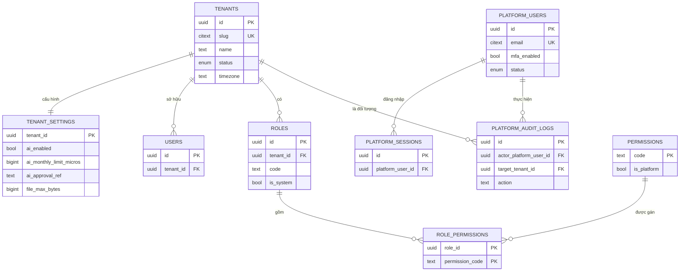
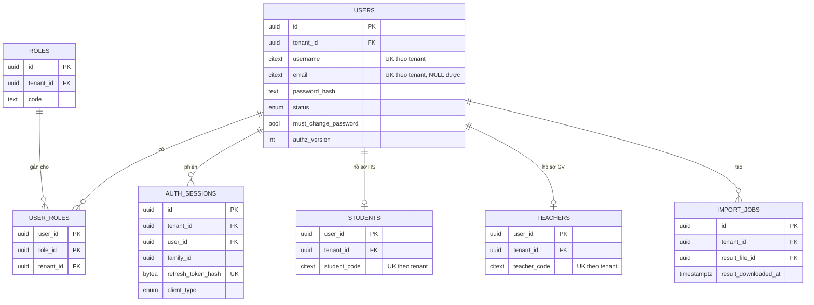
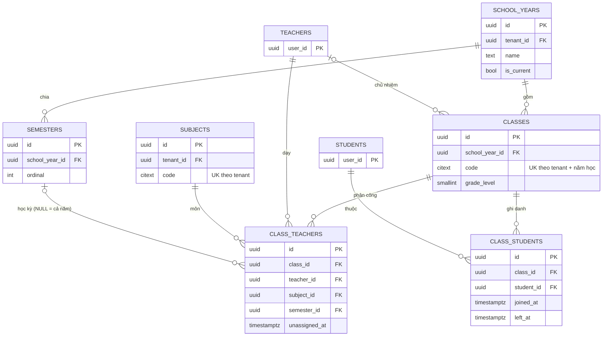
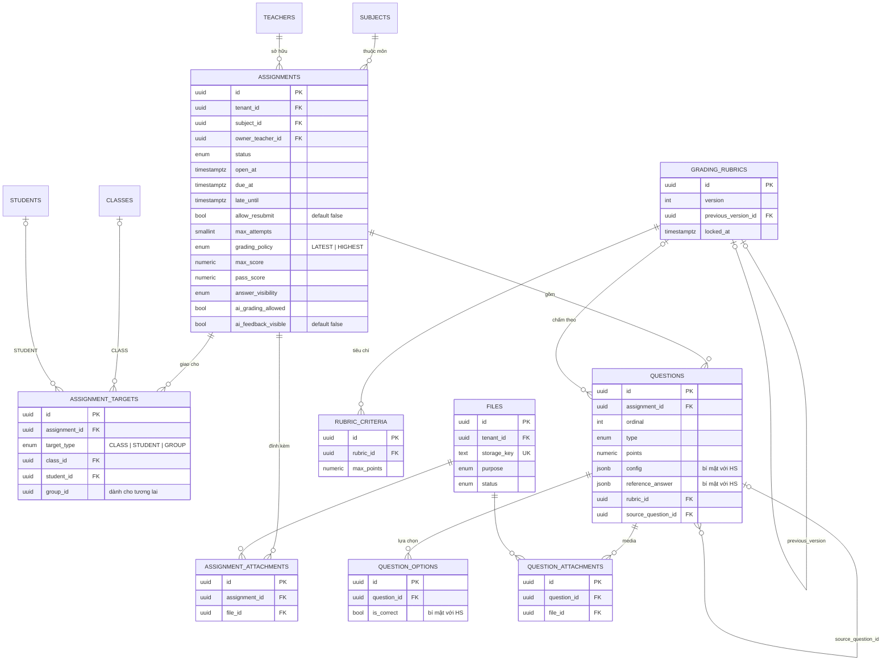
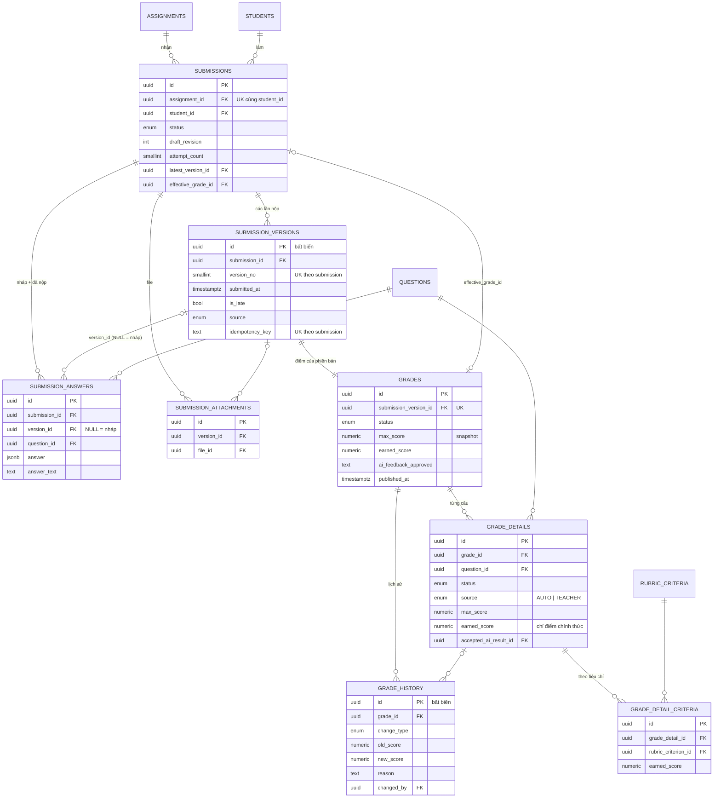
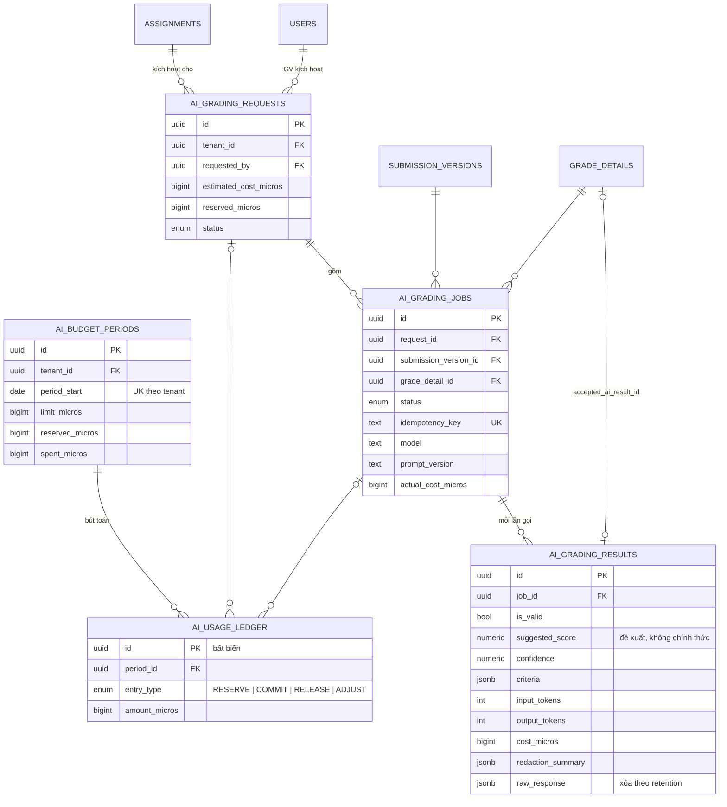
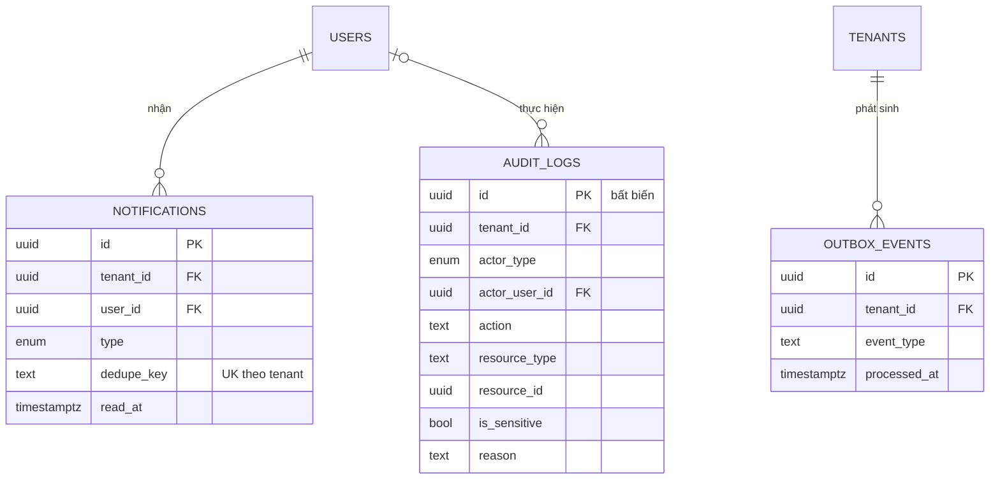

# ERD – Homework Management System

> **DRAFT – soạn sớm theo yêu cầu, chờ duyệt ở Phase 2.** Định nghĩa cột và ràng buộc đầy đủ: [database-design.md](./database-design.md).
> Để dễ đọc, ERD được tách theo miền. Mọi thực thể trong tenant đều có `tenant_id` và **khóa ngoại kép** `(tenant_id, …)`; sơ đồ chỉ ghi các cột chính.

---

## 1. Nền tảng & tenant

`AI_MODEL_PRICING` và `PLATFORM_SETTINGS` là bảng độc lập của nền tảng (không có quan hệ khóa ngoại).

## 2. Danh tính trong tenant

## 3. Học vụ

## 4. Bài tập, câu hỏi, rubric, file

## 5. Bài nộp & chấm điểm

## 6. AI grading & ngân sách

## 7. Thông báo, audit, outbox

---

## 8. Giải thích các quan hệ quan trọng

1. **Tenant → mọi thứ.** Mọi thực thể nghiệp vụ thuộc một tenant. Khóa ngoại kép `(tenant_id, x_id) → x(tenant_id, id)` khiến DB từ chối mọi liên kết chéo tenant, kể cả khi lớp ứng dụng có lỗi. RLS chặn đọc/ghi ngoài tenant context.
2. **User – Student/Teacher (1–0..1).** `users` giữ danh tính đăng nhập; `students`/`teachers` giữ hồ sơ nghiệp vụ. Một user có thể vừa là GV vừa là School Admin (qua `user_roles`). Mã HS là username, duy nhất trong tenant (D4).
3. **Phân công là bộ ba (lớp, GV, môn) [+ học kỳ].** Quyền của GV với bài tập/bài nộp suy ra từ `class_teachers` đang hiệu lực, **không** từ việc GV đã tạo bài. Vì vậy gỡ phân công thì mất quyền ngay (BR-03).
4. **Đối tượng nhận bài là đa hình có kiểm soát.** `assignment_targets` dùng `target_type` + cột khóa ngoại tương ứng (không dùng "polymorphic id" không có FK), nên vẫn có toàn vẹn tham chiếu. `GROUP` được dành sẵn cho D12.
5. **Submission (1 HS × 1 bài) → nhiều phiên bản bất biến.** Bản nháp là các dòng `submission_answers` có `version_id = NULL`. Khi nộp, nháp được sao chép thành dòng gắn phiên bản mới, không ghi đè (D6.2).
6. **Mỗi phiên bản có một bản ghi điểm (`grades`).** Điểm hiệu lực của submission là `effective_grade_id`, được tính theo `grading_policy` (`LATEST` – D6.1; `HIGHEST` – D6.4) mỗi khi công bố. `max_score`/`earned_score` được lưu ở cả mức bài và mức câu, với `max_score` là snapshot (D5.2).
7. **Điểm AI tách khỏi điểm chính thức.** `ai_grading_results.suggested_score` không bao giờ được ghi vào `grade_details.earned_score`. Chỉ khi GV chấp nhận/sửa mới tạo điểm nguồn `TEACHER` và lưu liên kết `accepted_ai_result_id` để truy vết (D9.2).
8. **Lịch sử điểm append-only.** Mọi thay đổi điểm/nhận xét tạo một dòng `grade_history` (D7.3).
9. **Rubric có version.** Câu hỏi trỏ tới một version rubric cụ thể. Rubric đã dùng để chấm thì bị khóa, sửa sẽ tạo version mới, nên điểm theo tiêu chí cũ vẫn diễn giải được.
10. **Ngân sách AI theo kỳ + sổ cái.** `ai_budget_periods` giữ số dư (đặt trước atomic), `ai_usage_ledger` giữ mọi bút toán để đối soát (D11.6, D11.8).
11. **Files là bảng trung tâm.** Mọi đính kèm tham chiếu `files`. Quyền tải file được suy ra từ bản ghi chủ (bài tập/câu hỏi/bài nộp), không từ bản thân file.
