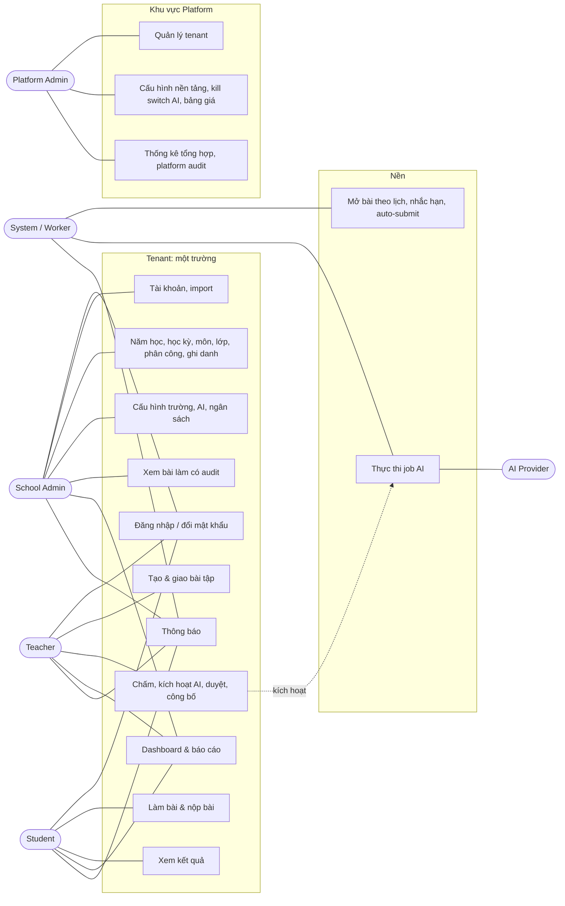

# Use Cases – Homework Management System

> Phase 1 – Discovery & Requirement Analysis · **Bản 2 – DRAFT chờ review**
> Mã chức năng (PLT-xx, ASG-xx…) và business rule (BR-xx): [requirements.md](./requirements.md). Quyết định (D-xx/O-xx): [decisions.md](./decisions.md). Trạng thái: [business-workflows.md](./business-workflows.md).
> **Mọi use case trong tenant đều có tiền điều kiện ngầm**: tenant context được xác định ở backend và tenant đang `ACTIVE` (BR-T02, BR-T04).

---

## 1. Sơ đồ tổng quan

---

## 2. Danh mục use case

### 2.1 Platform Admin

| ID | Use case | Chức năng |
|---|---|---|
| UC-P01 | Đăng nhập khu vực Platform (mật khẩu + TOTP) | PLT-01 |
| UC-P02 | Tạo tenant + School Admin đầu tiên | PLT-02 |
| UC-P03 | Sửa / tạm ngưng / kích hoạt lại tenant | PLT-03 |
| UC-P04 | Cấu hình trần nền tảng (file, hạn mức mặc định) | PLT-04 |
| UC-P05 | Bật/tắt AI toàn nền tảng, quản lý bảng giá model | PLT-05 |
| UC-P06 | Xem thống kê tổng hợp & chi phí AI theo tenant | PLT-06 |
| UC-P07 | Xem platform audit log | PLT-07 |

### 2.2 Chung trong tenant

| ID | Use case | Actor | Chức năng |
|---|---|---|---|
| UC-01 | Đăng nhập (HS bằng mã học sinh) | School Admin, Teacher, Student | AUTH-01..03, AUTH-08 |
| UC-02 | Đăng xuất (phiên này / mọi phiên) | Tất cả | AUTH-05 |
| UC-03 | Đổi mật khẩu (kể cả bắt buộc lần đầu) | Tất cả | AUTH-06 |
| UC-04 | Xem & quản lý thông báo | Tất cả | NTF-01..05 |
| UC-05 | Xem/cập nhật hồ sơ cá nhân | Tất cả | – |

### 2.3 School Admin

| ID | Use case | Chức năng |
|---|---|---|
| UC-10 | Tạo tài khoản giáo viên | ADM-01 |
| UC-11 | Tạo tài khoản học sinh | ADM-02 |
| UC-12 | Import tài khoản từ Excel | ADM-03 |
| UC-13 | Sửa / khóa / mở khóa tài khoản, reset mật khẩu | ADM-01, ADM-02, AUTH-07 |
| UC-14 | Quản lý năm học & học kỳ | ADM-04 |
| UC-15 | Quản lý môn học | ADM-05 |
| UC-16 | Tạo / sửa / lưu trữ lớp | ADM-06 |
| UC-17 | Phân công giáo viên | ADM-07 |
| UC-18 | Gỡ phân công giáo viên (chuyển quyền sở hữu bài tập) | ADM-07 |
| UC-19 | Ghi danh / gỡ / chuyển lớp học sinh | ADM-08 |
| UC-20 | Cấu hình trường | ADM-09 |
| UC-21 | Cấu hình AI của trường & ngân sách | ADM-10 |
| UC-22 | Xem nội dung bài làm / điểm (có lý do, audit) | ADM-11 |
| UC-23 | Xem audit log của trường | ADM-12 |
| UC-24 | Dashboard trường, thống kê AI, xuất Excel | ADM-13, RPT-03, RPT-05, RPT-07 |

### 2.4 Teacher

| ID | Use case | Chức năng |
|---|---|---|
| UC-30 | Dashboard giáo viên | RPT-01 |
| UC-31 | Xem lớp được phân công, danh sách HS, lịch sử học tập | CLS-01..04 |
| UC-32 | Tạo bài tập (nháp) | ASG-01..05 |
| UC-33 | Quản lý câu hỏi | QST-01..08 |
| UC-34 | Tạo rubric & đáp án tham khảo | QST-09, GRD-04 |
| UC-35 | Tái sử dụng câu hỏi / nhân bản bài tập | ASG-16, QST-10 |
| UC-36 | Giao bài & cấu hình nộp/chấm | ASG-06..07, ASG-09..10, ASG-12..13, ASG-17..19 |
| UC-37 | Gia hạn / thu hồi / khôi phục / lưu trữ | ASG-14, ASG-15, ASG-21 |
| UC-38 | Theo dõi bài nộp | GRD-01 |
| UC-39 | Chấm thủ công | GRD-03, GRD-12 |
| UC-40 | **Kích hoạt chấm AI** | GRD-05 |
| UC-41 | Duyệt / sửa điểm và nhận xét AI | GRD-06 |
| UC-42 | Yêu cầu AI chấm lại | GRD-11 |
| UC-43 | Ghi đè điểm tự động | GRD-07 |
| UC-44 | Công bố điểm | GRD-08 |
| UC-45 | Sửa điểm sau công bố | GRD-10 |
| UC-46 | Yêu cầu HS nộp lại | GRD-09 |
| UC-47 | Sửa đáp án đúng → chấm lại tự động | GRD-13 |
| UC-48 | Báo cáo lớp/môn, xuất Excel | RPT-04, RPT-05 |

### 2.5 Student

| ID | Use case | Chức năng |
|---|---|---|
| UC-60 | Dashboard học sinh | RPT-02 |
| UC-61 | Xem & lọc danh sách bài tập | SUB-01, SUB-02 |
| UC-62 | Xem chi tiết bài tập | SUB-02 |
| UC-63 | Bắt đầu làm bài | SUB-03 |
| UC-64 | Trả lời & tự động lưu nháp | SUB-04..08 |
| UC-65 | Nộp bài | SUB-09, SUB-10 |
| UC-66 | Nộp lại (khi GV bật hoặc GV yêu cầu) | SUB-11 |
| UC-67 | Xem kết quả đã công bố | SUB-13 |
| UC-68 | Xem lịch sử các lần nộp | SUB-14 |

### 2.6 System / Worker

| ID | Use case | Chức năng |
|---|---|---|
| UC-80 | Mở bài theo lịch | ASG-09 |
| UC-81 | Nhắc sắp đến hạn | NTF-01 |
| UC-82 | Thông báo quá hạn | NTF-01 |
| UC-83 | Auto-submit khi hết giờ | SUB-06 |
| UC-84 | Chấm tự động (rule engine) | GRD-02 |
| UC-85 | Thực thi job AI do GV kích hoạt | GRD-05, BR-40..48 |
| UC-86 | Cảnh báo ngân sách AI | NTF-01, BR-45 |
| UC-87 | Dọn file mồ côi, dọn dữ liệu hết hạn lưu trữ | FIL-04, O-15 |

---

## 3. Đặc tả chi tiết các use case trọng yếu

### UC-P02 Tạo tenant

| Mục | Nội dung |
|---|---|
| Actor | Platform Admin |
| Luồng chính | 1. Nhập tên trường, mã trường (slug: chữ thường, số, gạch ngang; duy nhất toàn nền tảng; không trùng danh sách từ dành riêng như `admin`, `api`, `www`), múi giờ, hạn mức (số user, dung lượng). 2. Nhập thông tin School Admin đầu tiên (họ tên, username, email). 3. Hệ thống (transaction với role DB `hms_system`): tạo `tenants`, `tenant_settings` (AI **tắt**, chưa có hạn mức AI), 3 role hệ thống + permission mặc định, user School Admin với mật khẩu tạm (O-18). 4. Ghi platform audit. |
| Luồng thay thế | 1a. Slug trùng hoặc thuộc danh sách dành riêng: lỗi. |
| Hậu điều kiện | `https://{slug}.<domain>` hoạt động; School Admin đăng nhập và buộc đổi mật khẩu |

### UC-01 Đăng nhập trong tenant

| Mục | Nội dung |
|---|---|
| Actor | School Admin, Teacher, Student |
| Tiền điều kiện | Truy cập qua subdomain của trường (hoặc nhập mã trường – O-01) |
| Luồng chính | 1. Backend xác định tenant từ host; tenant phải `ACTIVE`. 2. Người dùng nhập định danh + mật khẩu: HS nhập **mã học sinh** (D4.1); GV/Admin nhập username hoặc email. 3. Kiểm tra rate limit (IP, tài khoản, tenant). 4. Tìm user theo `(tenant_id, định danh đã chuẩn hóa)`, so khớp Argon2id. 5. Kiểm tra trạng thái tài khoản. 6. Tạo `auth_sessions`, đặt cookie `__Host-` cho access token, refresh token và CSRF token. 7. Audit `auth.login.success`. 8. Điều hướng theo role. |
| Luồng thay thế | 4a. Sai thông tin: thông báo chung, không tiết lộ tài khoản có tồn tại hay không; audit `auth.login.failed`. 3a. Vượt ngưỡng: khóa tạm tăng dần. 5a. Tài khoản bị khóa: từ chối. 5b. `must_change_password`: chuyển UC-03. 1a. Tenant bị tạm ngưng: trang thông báo riêng, không cho nhập. |
| Ghi chú | Một mã HS ở trường A không đăng nhập được ở trường B, kể cả khi trùng mã (D4.2, O-02) |

### UC-11 / UC-12 Tạo & import học sinh

| Mục | Nội dung |
|---|---|
| Luồng chính | 1. Nhập họ tên, **mã học sinh** (bắt buộc, duy nhất trong tenant), ngày sinh (tùy chọn), lớp (tùy chọn). 2. Hệ thống sinh mật khẩu tạm **ngẫu nhiên** (≥ 12 ký tự, không suy ra từ mã HS – D4.3), `must_change_password = true`. 3. Transaction: `users` (username = mã HS đã chuẩn hóa) + `user_roles(STUDENT)` + `students` (+ `class_students`). 4. Bàn giao mật khẩu tạm một lần (O-18). 5. Audit. |
| Import Excel | Tải mẫu → upload → server validate từng dòng (trùng mã trong file, trùng với DB, thiếu trường) → preview → xác nhận → tạo theo lô (mỗi lô một transaction) → file kết quả kèm mật khẩu tạm, tải **một lần** (link hết hạn) |
| Hậu điều kiện | Kiểm thử bắt buộc #2/#4: kiểm tra DB đủ bản ghi, mật khẩu là hash Argon2id, không có mật khẩu dạng rõ trong DB/log, audit tồn tại |

### UC-18 Gỡ phân công giáo viên

| Mục | Nội dung |
|---|---|
| Luồng chính | 1. School Admin gỡ GV khỏi (lớp, môn). 2. Hệ thống liệt kê bài đang mở và bài chờ chấm của GV cho lớp đó. 3. Chọn GV nhận quyền sở hữu (hoặc giữ nguyên, GV cũ vẫn mất quyền truy cập). 4. Tăng `authz_version` của GV, invalidate cache phân quyền. 5. Audit. |
| Hậu điều kiện | Request tiếp theo của GV cũ tới tài nguyên lớp đó trả 403 |

### UC-21 Cấu hình AI của trường

| Mục | Nội dung |
|---|---|
| Actor | School Admin (permission `tenant.ai.manage`) |
| Tiền điều kiện | Công tắc AI nền tảng đang bật. Nếu tắt, màn hình chỉ hiển thị "AI chưa được kích hoạt trên nền tảng" |
| Luồng chính | 1. Xem trạng thái: AI trường (tắt mặc định), hạn mức tháng, đã dùng, đã đặt trước. 2. Bật AI: bắt buộc nhập thông tin **phê duyệt xử lý dữ liệu** (người phê duyệt, ngày, số văn bản/ghi chú, phạm vi) và tick xác nhận đã đọc chính sách dữ liệu gửi tới nhà cung cấp AI. 3. Đặt hạn mức tháng (USD – O-12), ngưỡng cảnh báo (mặc định 50/80/100%), tùy chọn hạn mức theo GV. 4. Lưu và audit (giá trị cũ/mới). |
| Luồng thay thế | 2a. Không có hạn mức: được lưu nhưng AI không chạy (BR-45). 3a. Hạn mức vượt trần nền tảng: lỗi. |
| Ghi chú | Theo **D11.1**, ở giai đoạn đầu công tắc nền tảng **tắt**, nên use case này chỉ được kiểm thử ở môi trường test với provider giả lập |

### UC-22 School Admin xem nội dung bài làm

| Mục | Nội dung |
|---|---|
| Tiền điều kiện | Có permission `submission.content.read` (O-04) |
| Luồng chính | 1. Từ báo cáo/lớp/bài tập, chọn một bài nộp. 2. Hệ thống yêu cầu **lý do truy cập** (chọn loại + ghi chú). 3. Ghi audit `SENSITIVE_READ` (actor, bài nộp, lý do, IP, thời điểm) **trước khi** trả dữ liệu. 4. Hiển thị chỉ đọc. |
| Luồng thay thế | 1a. Không có permission: 403, audit `access.denied`. |
| Ghi chú | Trong cùng một phiên xem, lý do được dùng lại tối đa 30 phút cho cùng bài tập, nhưng **mỗi lần mở bài nộp vẫn ghi 1 bản ghi audit** |

### UC-32 → UC-36 Giáo viên tạo và giao bài tập

| Mục | Nội dung |
|---|---|
| Tiền điều kiện | GV được phân công ít nhất 1 (lớp, môn) |
| Luồng chính | 1. Tạo bài `DRAFT`: tiêu đề, môn (chỉ môn được phân công), chủ đề, mô tả, hướng dẫn, file đính kèm (PDF/DOCX/… – D13). 2. Thêm câu hỏi (rich text, công thức, ảnh, file); đáp án đúng; điểm; bắt buộc. Tự luận: đáp án tham khảo + rubric. 3. Hệ thống tính `max_score` = tổng điểm câu (D5.1); GV đặt `pass_score`. 4. Xem trước. 5. Giao bài: lớp (chỉ lớp được phân công cho môn đó) và/hoặc từng HS; `open_at`, `due_at`, nộp muộn + `late_until`; **cho phép nộp lại (mặc định tắt)** + `max_attempts`; thời gian làm bài; chính sách đáp án; **cho phép dùng AI** (chỉ hiện khi trường bật AI); **công bố nhận xét AI cho HS (mặc định tắt)**. 6. Validate BR-10. 7. `PUBLISHED` hoặc `SCHEDULED`. 8. Audit. |
| Luồng thay thế | 5a. Lớp không được phân công: 403. 6a. Vi phạm ràng buộc: lỗi chi tiết, giữ `DRAFT`. 2a. SC có ≠ 1 đáp án đúng / MC không có đáp án đúng / T/F thiếu đáp án: lỗi. |
| Kiểm thử bắt buộc | #6, #7: số `assignment_targets`, số thông báo đúng tập HS, HS ngoài lớp và **HS tenant khác** không thấy bài |

### UC-63 → UC-65 Học sinh làm bài và nộp bài

| Mục | Nội dung |
|---|---|
| Tiền điều kiện | Bài hiển thị với HS (BR-11), còn quyền làm bài |
| Luồng chính | 1. "Bắt đầu làm bài". 2. Server tạo/lấy submission (unique theo bài + HS), `IN_PROGRESS`, `started_at`, trả `server_now`, `deadline`, câu hỏi **không kèm đáp án**. 3. Autosave (debounce ~2–3s và khi chuyển câu) kèm `revision`. 4. "Nộp bài" → xác nhận (đã làm/chưa làm, câu bắt buộc). 5. `POST /submit` + `Idempotency-Key`. 6. Transaction + khóa dòng: kiểm tra BR-23, BR-26; tạo phiên bản bất biến; `is_late`; chấm tự động; câu không chấm tự động được → `NEEDS_MANUAL`; trạng thái. 7. Sau commit (outbox): thông báo GV (gom nhóm). **Không enqueue AI** (D9.1). 8. Trả "Đã nộp lúc …". |
| Luồng thay thế | 3a. Mất mạng: bản nháp tạm ở localStorage, thử lại (chỉ chứa câu trả lời, không chứa token). 3b. Xung đột revision: yêu cầu tải lại. 4a. Thiếu câu bắt buộc: chặn. 5a. Request trùng: trả kết quả lần đầu. 6a. Hết hạn: từ chối, giữ nháp. 6b. Hết lượt: từ chối. 6c. Hết giờ: UC-83. |
| Kiểm thử bắt buộc | #9–#13, nộp trùng, nộp sau hạn, nộp lại, nhiều HS nộp cùng lúc |

### UC-66 Nộp lại

| Mục | Nội dung |
|---|---|
| Tiền điều kiện | (`allow_resubmit = true` **và** `attempt_count < max_attempts` **và** còn hạn) **hoặc** submission đang `RETURNED` (GV yêu cầu) – D6.3, BR-28, BR-29 |
| Luồng chính | 1. "Nộp lại". 2. Bản nháp mới khởi tạo từ phiên bản gần nhất. 3. Làm UC-64/65 → `version_no + 1`. 4. Job AI đang chờ/chạy của phiên bản cũ bị hủy. 5. Phiên bản cũ và điểm của nó giữ nguyên trong lịch sử (D6.2). Điểm hiệu lực đổi sang phiên bản mới khi phiên bản mới được công bố (D6.1, O-09). |

### UC-40 Giáo viên kích hoạt chấm AI

| Mục | Nội dung |
|---|---|
| Actor | Teacher (permission `ai_grading.request`, scope lớp được phân công) |
| Tiền điều kiện | 4 cổng đầu của BR-40 mở: nền tảng bật, trường bật + đã ghi nhận phê duyệt, bài cho phép AI, có hạn mức. Câu cần chấm là Essay hoặc Short Answer không khớp quy tắc, đang `NEEDS_MANUAL` hoặc `AI_SUGGESTED` (chấm lại) |
| Luồng chính | 1. GV chọn phạm vi: 1 bài nộp / các bài nộp đã chọn / mọi bài nộp chờ chấm của bài tập; chọn câu. 2. Hệ thống tính **ước tính chi phí** (ước lượng token cục bộ, **không** gửi dữ liệu ra ngoài) và số dư ngân sách. 3. Hiển thị xác nhận: số câu sẽ chấm, chi phí ước tính, lưu ý "dữ liệu đã ẩn danh sẽ được gửi tới nhà cung cấp AI". 4. GV xác nhận → **đặt trước ngân sách** (atomic). 5. Tạo `ai_grading_jobs` (`QUEUED`), câu sang `AI_PENDING`, submission sang `GRADING`. 6. Audit `ai_grading.requested`. |
| Luồng thay thế | 1a. Cổng nào đóng: nút "Chấm bằng AI" bị vô hiệu kèm lý do. 4a. Không đủ ngân sách cho toàn bộ: chặn, đề xuất giảm phạm vi. |
| Hậu điều kiện | Job chờ worker (UC-85). Không có gì được công bố |

### UC-85 Thực thi job AI

| Mục | Nội dung |
|---|---|
| Actor | System, AI Provider |
| Luồng chính | 1. Worker nhận job → `PROCESSING`; kiểm tra lại các cổng (kill switch có thể đã tắt) và phiên bản bài nộp còn hiệu lực. 2. **Ẩn danh** (BR-41) → dựng prompt (version cố định): đề, đáp án tham khảo, rubric, bài làm trong khối dữ liệu riêng. 3. Gọi provider với JSON schema, timeout. 4. Validate (schema, giới hạn điểm, đủ tiêu chí); tính lại tổng. 5. Lưu `ai_grading_results` (model, prompt version, token, chi phí, độ trễ). 6. Quyết toán ngân sách theo token thực tế. 7. Câu → `AI_SUGGESTED`. 8. Khi hết job của bài nộp → thông báo GV. 9. Kiểm tra ngưỡng ngân sách → UC-86. |
| Luồng thay thế | 1a. Cổng đã đóng: `CANCELLED`, hoàn ngân sách đặt trước, câu về `NEEDS_MANUAL`. 3a. Timeout/429/5xx: retry backoff. 3b. Refusal hoặc lỗi 4xx: `FAILED`. 4a. Output không hợp lệ: retry 1 lần rồi `FAILED`. Mọi nhánh lỗi: hoàn phần ngân sách chưa dùng, câu về `NEEDS_MANUAL`, thông báo GV, bài nộp không đổi. |

### UC-41 Duyệt / sửa điểm và nhận xét AI

| Mục | Nội dung |
|---|---|
| Tiền điều kiện | GV đang được phân công lớp của bài nộp |
| Luồng chính | 1. Grading workspace: **trái** là bài làm, **phải** là điểm từng câu/tiêu chí + gợi ý AI (điểm, lý do, ý thiếu, confidence, cờ cần xem kỹ). 2. Với mỗi câu có gợi ý AI: "Chấp nhận" hoặc sửa điểm từng tiêu chí **và** chỉnh nhận xét. 3. Lưu → `grade_details` nguồn `TEACHER`, trạng thái `FINAL`, liên kết kết quả AI đã dùng; ghi `grade_history` (loại `AI_ACCEPTED` hoặc `AI_MODIFIED`). 4. Nhận xét AI dành cho HS chỉ được đưa ra khi GV đã duyệt (D10.2). |
| Kiểm thử bắt buộc | #15, #16: DB tách bạch điểm AI và điểm GV; lịch sử có bản ghi; HS chưa thấy gì trước khi công bố |

### UC-44 Công bố điểm

| Mục | Nội dung |
|---|---|
| Luồng chính | 1. Chọn bài `GRADED` → "Công bố". 2. Kiểm tra BR-34 từng bài. 3. `PUBLISHED`, `published_at`, `published_by`; cập nhật điểm hiệu lực theo `grading_policy`. 4. Outbox → thông báo HS. 5. Audit. |
| Kiểm thử bắt buộc | #17, #18 |

### UC-67 Học sinh xem kết quả

| Mục | Nội dung |
|---|---|
| Hiển thị | `earned_score` / `max_score`, Đạt/Chưa đạt, điểm từng câu, câu trả lời, đáp án đúng (theo chính sách), nhận xét GV, nhận xét AI **chỉ khi** bài bật công bố và GV đã duyệt |
| Ngoại lệ | Truy cập kết quả của HS khác hoặc của tenant khác: **404** |

---

## 4. Ánh xạ 20 luồng kiểm thử bắt buộc

| # | Luồng | Use case | Ghi chú multi-tenant / AI |
|---|---|---|---|
| 1 | Admin đăng nhập | UC-01 (School Admin), UC-P01 (Platform) | Kiểm tra cả 2 khu vực |
| 2 | Admin tạo tài khoản giáo viên | UC-10 | `tenant_id` đúng |
| 3 | Admin tạo lớp học | UC-16 | |
| 4 | Admin thêm học sinh vào lớp | UC-19 | Không thêm được HS của tenant khác |
| 5 | Giáo viên đăng nhập | UC-01 | |
| 6 | Giáo viên tạo bài tập | UC-32..34 | |
| 7 | Giáo viên giao bài cho lớp | UC-36 | |
| 8 | Học sinh đăng nhập | UC-01 | Bằng mã học sinh |
| 9 | Học sinh xem bài tập | UC-61, UC-62 | |
| 10 | Học sinh làm bài | UC-63, UC-64 | |
| 11 | Học sinh lưu bản nháp | UC-64 | |
| 12 | Học sinh nộp bài | UC-65 | |
| 13 | Chấm trắc nghiệm tự động | UC-84 | |
| 14 | AI chấm bài tự luận | UC-40, UC-85 | Dùng **provider giả lập** (D11.1, D11.9); kiểm tra payload đã ẩn danh |
| 15 | Giáo viên duyệt điểm AI | UC-41 | |
| 16 | Giáo viên chỉnh sửa điểm | UC-39, UC-43, UC-45 | |
| 17 | Giáo viên công bố điểm | UC-44 | |
| 18 | Học sinh xem kết quả | UC-67 | |
| 19 | Hệ thống gửi thông báo | UC-04, UC-80..82, UC-86 | |
| 20 | Kiểm tra truy cập trái phép | Tất cả | Gồm **truy cập chéo tenant** (xem business-workflows §8) |
